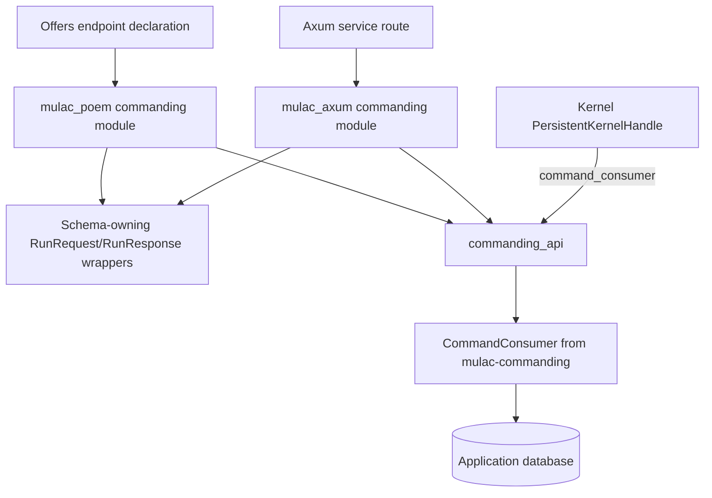

# Mulac commanding API adapters implementation plan

Status: Implemented, except the deferred steps listed in
[Implementation notes](#implementation-notes).

## Objective and scope

Implement the empty `libs/commanding_api` skeleton in Mulac. Add commanding
support to the existing Poem and Axum adapters behind an opt-in `commanding`
feature. Then reduce offers' `POST /commands/run` endpoint to a declaration
and a delegation call. Both adapters use the same validation and execution
logic.

This covers only `POST /commands/run`, mounted under `/api` in offers. It
follows the inbox extraction described in
[the inbox adapters plan](../services/offers/docs/inbox-api-adapters-plan.md)
and Mulac's
[ADR-009](../../mulac/docs/adr/009-inbox-http-adapters.md).
`POST /events/run` and `POST /outbox/run` keep their current behavior. They are
planned separately in `docs/offers-eventing-api-plan.md` and
`docs/offers-outbox-api-plan.md`. Commanding is the first of the three to
land; see section 10.

The implementation targets the Mulac checkout referenced by offers:
`/home/nulllabs/work/bodul/mulac`.

Names in this document are proposed unless they are cited from current code.
Current code is cited by path and item name.

## 1. Establish the crate boundaries

Current state:

| Location | Current state |
| --- | --- |
| `libs/commanding` (`mulac-commanding`) | `CommandConsumer::consume(&ReservableCommandSpec) -> Result<usize, Vec<CommandError>>`, reservation, retry and dead-lettering |
| `libs/commanding_api` | Skeleton: empty `[dependencies]`, placeholder test, README saying it has no code yet |
| `libs/inbox_api` | `RunRequest` and `RunResponse`, with `InboxApiError` as the error type |
| `libs/mulac_poem` | `InboxAdapter`, plus Poem wrappers `RunRequest` and `RunResponse` around the `inbox_api` types; schema twins in `src/types.rs` |
| `libs/mulac_axum` | `InboxAdapter`, `RunInbox`, `InboxRunResponse`, `InboxHttpError`; optional Utoipa twins in `src/schema.rs` |
| `kernel` (`mulac-kernel`) | `PersistentKernelHandle::command_consumer() -> Arc<CommandConsumer>` |

Target state:

| Location | Responsibility |
| --- | --- |
| `libs/commanding_api` | Its own run types, commanding run operation, typed errors, optional Tokio execution, test fixtures |
| `libs/mulac_poem` | Private `commanding` module behind the opt-in `commanding` feature, with a Poem `CommandingAdapter` |
| `libs/mulac_axum` | Private `commanding` module behind the opt-in `commanding` feature, with an Axum `CommandingAdapter`, extractor, response and error types |
| `libs/inbox_api` | Unchanged |

Keep reservation, dispatch, retry backoff, and the six-attempt limit in
`mulac-commanding`. `commanding_api` does not construct a dispatcher or
handler registry, and it does not depend on the kernel, `inbox_api`, or any
framework.



Each crate exposes its public interface only through `pub mod io`, following
Mulac's `AGENTS.md`. Internal modules stay private.

### Adapter placement: existing crates, opt-in feature

Put the commanding adapters in `mulac_poem` and `mulac_axum` as private
`commanding` modules, re-exported through `io` under `#[cfg(feature =
"commanding")]`. Do not create per-component adapter crates.

- ADR-009 names the adapter crates by framework, not by component. Separate
  crates per component and framework would grow to eight crates to version
  and publish once events and outbox follow.
- Each framework must keep exactly one schema-owning `RunRequest`/`RunResponse`
  pair (section 3). That is only possible if every queue adapter lives in the
  same crate per framework.
- The non-default `commanding` feature keeps the default adapter build to
  what it is today. Applications that only need the inbox pay nothing for
  commanding.

Feature definition in both adapter manifests (proposed):

```toml
[features]
default = ["diesel"]
diesel = ["inbox_api/diesel"]
commanding = ["dep:commanding_api"]

[dependencies]
commanding_api = { workspace = true, features = ["tokio"], optional = true }
```

The eventing and outbox extractions add `eventing` and `outbox` features in
the same way.

## 2. Freeze the existing HTTP contract

Current behavior lives in `services/offers/src/orchestration/api.rs`:

- `QueueApi::run_commands` takes `Json<RunRequest>` (imported from
  `mulac_poem::io`), calls `self.kernel.command_consumer()`, and runs
  `consumer.consume(&ReservableCommandSpec::new(request.limit))` inside
  `QueueApi::run`.
- `QueueApi::run` wraps the work in `tokio::task::spawn_blocking` and maps a
  join failure to `err_queue_task_failed()`: status `500`, text
  `queue processing task failed`.
- The result goes through `RunResponse::from_result`. In
  `inbox_api::io::RunResponse::from_result`, `Ok(n)` becomes
  `{"processed":n,"errors":[]}` and `Err(errors)` becomes
  `{"processed":null,"errors":[...]}`, with each error's `Display` text.
- The limit is validated by the Poem wrapper's `parse_run_request`
  (`libs/mulac_poem/src/types.rs`), using `RunRequest::MIN_LIMIT = 1` and
  `RunRequest::MAX_LIMIT = 1000` from `libs/inbox_api/src/contract.rs`. The
  validation message is `limit must be between 1 and 1000` from
  `InboxApiError::LimitOutOfRange`.
- `ReservableCommandSpec::new` uses
  `ReservableCommandSpec::DEFAULT_MAX_ATTEMPTS = 6`.
- `CommandConsumer::process_entry` pushes the failure-marking error, if any,
  before the dispatch error. So one failed command can contribute two entries.
- Unlike `/outbox/run`, there is no `503` path: the kernel consumer always
  exists.

Before extraction, extend the characterization tests where the table marks
gaps.

| Case | Required behavior | Current evidence |
| --- | --- | --- |
| Valid limit, work processed | `200`, `{"processed":N,"errors":[]}` | `postgres_tests.rs`: `queue_endpoints_process_one_stage_and_preserve_unavailable_outbox` |
| No eligible work | `200`, `{"processed":0,"errors":[]}` | Same test (`run_queue(&client, "commands", 10, 0)`) |
| Batch limit | Processes at most `limit` commands | Same test (`run_queue(&client, "commands", 1, 1)`) |
| Limit bounds | `1` and `1000` accepted | `main.rs`: `queue_routes_validate_requests_and_report_failures` |
| Invalid limit | `400` for `{}`, `0`, `1001`, `-1`, `1.5`, `"1"` and malformed JSON `{` | Same test |
| `{"limit":null}`, `{"limit":1.0}`, `[]` | `400` | Gap: only tested for `/inbox/run` (`inbox_api.rs` tests); add for commands |
| Unknown fields | `{"limit":1,"extra":true}` accepted | Gap: only tested for `/inbox/run`; add |
| Missing or `text/plain` content type | `415` | Gap: only tested for inbox routes (`inbox_routes_require_json_content_type`); add |
| Reservation or storage failure | `200`, `{"processed":null,"errors":[...]}`, one or more `CommandError` strings, e.g. `reservation error: ...` | `main.rs`: `queue_routes_validate_requests_and_report_failures` (unreachable test pool) |
| Handler failure | `200`, `processed: null`; error text is the `CommandError` display, e.g. `no handler registered for command type '...'`; the row is rescheduled with backoff and becomes dead after six attempts | Gap: add a PostgreSQL test |
| Partial batch failure | Successful commands stay completed; `processed` is `null` | Gap: add a PostgreSQL test |
| Blocking-task failure | `500`, text `queue processing task failed` | Gap: not reachable in offers today; cover in Mulac with a panicking double, then in offers through adapter injection |
| Stage isolation | Commands run neither consumes inbox rows nor dispatches events; resulting events stay queued | `queue_endpoints_process_one_stage_and_preserve_unavailable_outbox`, `inbox_submission_processes_offer_through_all_http_stages` |
| OpenAPI | Request schema `RunRequest` (`limit` with `minimum` 1, `maximum` 1000), response schema `RunResponse`, only a `200` response, route registered under `/api` | `openapi_spec_matches_routes` checks the path and the `RunRequest` bounds; add `$ref` assertions for `/commands/run` |
| Authentication | None | README, "queue APIs" section |

Preserve the batch error strings. Batch responses expose `CommandError`
messages today; sanitizing them would be a separate behavior change. The
README documents this behavior ("or `{"processed":null,"errors":["…"]}` for
consumer errors, including storage failures").

Poem-generated wording for malformed bodies does not need to be frozen. The
status, the response shapes and Mulac's own messages must match across both
frameworks.

## 3. Define the commanding run contract

### Per-crate run types

`commanding_api` defines its own framework-free run types. It does not reuse
the `inbox_api` types and does not depend on `inbox_api`.

| Proposed type | Copied from | Behavior |
| --- | --- | --- |
| `RunCommandsRequest` | `inbox_api::io::RunRequest` | `limit: usize`; `MIN_LIMIT = 1`, `MAX_LIMIT = 1000`; `from_json` and `validate`; unknown fields ignored |
| `RunCommandsResponse` | `inbox_api::io::RunResponse` | `processed: Option<usize>`, `errors: Vec<String>`; `from_result` with the same `Ok`/`Err` mapping |

The copies keep the exact error strings: `limit must be between 1 and 1000`,
and the Serde message for malformed requests. Build them in named helpers
(`err_limit_out_of_range`, `err_malformed_request`), following
`libs/inbox_api/src/error.rs`. `inbox_api` stays unchanged, so nothing
breaks for existing callers.

The eventing and outbox plans define `RunEventsRequest`/`RunEventsResponse`
and `RunOutboxRequest`/`RunOutboxResponse` in the same way.

### Avoiding the OpenAPI schema-name collision

poem-openapi and Utoipa key component schemas by name. Offers registers
`RunRequest` and `RunResponse` once today, because every run route imports
`mulac_poem::io::{RunRequest, RunResponse}`. Each framework keeps exactly one
schema-owning wrapper pair, and the per-crate types are never published as
schemas.

- **Poem:** the existing `mulac_poem::io::{RunRequest, RunResponse}` remain
  the only schema owners. They stay unconditional, outside any component
  feature, because every queue module uses them. The commanding module
  converts `RunRequest` into `RunCommandsRequest` and `RunCommandsResponse`
  into `RunResponse` with named conversion helpers. These are allowed under
  the orphan rule because the wrappers are local to `mulac_poem`.
- **Axum:** the `utoipa` twins `twins::RunRequest` and `twins::RunResponse`
  in `libs/mulac_axum/src/schema.rs` remain the only schema owners. The new
  commanding extractor and response publish them through the existing
  `schema_as!` macro, as `RunInbox` and `InboxRunResponse` do.

The published OpenAPI document stays unchanged: `/commands/run` keeps
`#/components/schemas/RunRequest` and `#/components/schemas/RunResponse`.

### Accepted trade-off

The limit bounds, limit error, and `from_result` logic now exist in
`inbox_api` and in each new `*_api` crate. That accepts a risk of drift in
exchange for independent crates and no breaking change. Shared test fixtures
catch drift (section 9). Every `*_api` crate's `testing` module exposes the
same run-request table, and every crate's tests run it, so a change to either
behavior or error text fails a test. In Poem the wrapper validates during
parsing and `commanding_api` validates again for direct callers, so the
duplicate check is intentional.

## 4. Implement the shared commanding API

Introduce these public concepts in `commanding_api::io`:

| Proposed type | Purpose |
| --- | --- |
| `RunCommandsRequest`, `RunCommandsResponse` | Run contract (section 3) |
| `CommandingService` | Synchronous `run(RunCommandsRequest) -> Result<RunCommandsResponse, CommandingApiError>` over an `Arc<CommandConsumer>` |
| `AsyncCommandingService` | Optional Tokio wrapper (feature `tokio`) |
| `CommandingApiError` | `MalformedRequest(String)` and `LimitOutOfRange { limit, min, max }` (client errors); `RunTaskFailed(cause)` (server error, displays `queue processing task failed`) |
| `CommandingApiError::is_client_error` | Mirrors `InboxApiError::is_client_error` for status mapping |
| `testing` module (feature `testing`) | Run fixtures and port-based doubles |

Implement `CommandingService::run` in this order:

1. Validate the request with `RunCommandsRequest::validate`, so direct
   callers get the same check as HTTP callers.
2. Build `ReservableCommandSpec::new(request.limit)`, keeping the default
   six attempts.
3. Call `CommandConsumer::consume`.
4. Convert the result with `RunCommandsResponse::from_result`. Consumer
   failures are data in a successful result, not an `Err`.

Implementation requirements:

- Construct every error in a named helper, such as `err_run_task_failed`.
- Keep the `JoinError` as `source()` without exposing it in `Display`.
- Do not add a maximum-attempts or retry parameter to the HTTP contract.
- Leave transactions, retries and reservation in `mulac-commanding`.

## 5. Centralize runtime and construction code

`AsyncCommandingService` owns the `spawn_blocking` call that `QueueApi::run`
performs today. It maps join failures to `RunTaskFailed`. It uses the caller's
runtime and creates no runtime, pool, worker or dispatcher. Dropping the
request future does not stop a command that has already started; document
this as in `inbox_api`.

Construction (proposed signatures):

```rust
// The application or kernel owns the dispatcher and handler registry.
let service = CommandingService::new(kernel.command_consumer());
let service = AsyncCommandingService::from(service);
```

Do not add a `from_postgres` constructor in this extraction. Unlike the inbox
consumer, a command consumer needs an application-specific
`CommandDispatcher` (handlers plus an `EventDispatchPort`), which the kernel
already assembles in `start_persistent`. Offers and `retailer_sourcing` both
obtain the consumer through `PersistentKernelHandle::command_consumer()`.

### Feature and Diesel audit

| Crate | Features today | Diesel reached through |
| --- | --- | --- |
| `mulac-eventing` | `default = ["diesel"]` | Own optional `diesel`, `mulac_diesel` |
| `mulac-commanding` | `default = ["diesel"]`; `diesel = ["dep:diesel", "dep:mulac_diesel", "eventing/diesel"]` | Depends on eventing with `default-features = false` |
| `mulac-inbox` | `default = ["diesel"]`; `amqp` implies `diesel` | Forwards `commanding/diesel` |
| `inbox_api` | `default = ["diesel"]`, `tokio`, `testing` | Depends on inbox and commanding with `default-features = false` |
| `mulac_poem`, `mulac_axum` | `default = ["diesel"]` forwarding `inbox_api/diesel` | Workspace `inbox_api` has `default-features = false` |
| `mulac-kernel` | `inbox` with `features = ["diesel"]` | Enables `commanding/diesel` by unification |

Verified with `cargo tree --offline --locked -e normal`: `mulac_poem`,
`mulac_axum` and `mulac-commanding` built with `--no-default-features`
contain no `diesel` package; `mulac_poem` with default features contains
Diesel.

Rules:

- `commanding_api`: features `tokio = ["dep:tokio"]` and `testing = []`, with
  no default features and no `diesel` feature. Depend on
  `commanding = { path = "../commanding", ..., default-features = false,
  package = "mulac-commanding" }`. Leaving out `default-features = false`
  would silently enable Diesel through `mulac-commanding`'s default.
- Declare `commanding_api` in `[workspace.dependencies]` of `libs/Cargo.toml`
  with `default-features = false`, like `inbox_api`.
- Adapters keep `default = ["diesel"]`. `commanding` is not a default
  feature, and it does not imply `diesel`.
- Offers enables Diesel anyway through the kernel. The audit protects other
  consumers and Mulac's tests.

Add these checks to Mulac's `make ci`:

- Clippy runs for `mulac_poem` and `mulac_axum` with
  `--no-default-features --features commanding`, so the feature builds alone.
  For `mulac_axum`, also run with `--features commanding,utoipa`.
- `cargo tree -p mulac_poem -e normal` and the same for `mulac_axum`, built
  with default features, contain no `commanding_api`. This proves the default
  build does not include the feature.
- `cargo tree -p commanding_api --features tokio -e normal` and
  `cargo tree -p mulac_poem --no-default-features --features commanding -e normal`
  (and the same for `mulac_axum`) contain no `diesel`.
- The existing framework-separation checks run with `--all-features`, so
  they also cover the new module.

The eventing and outbox extractions repeat the per-feature checks for their
own features.

## 6. Implement the Poem adapter

`mulac_poem` gains a private `commanding` module behind the `commanding`
feature, re-exported through `io`:

- `CommandingAdapter` (proposed): cloneable, holds `AsyncCommandingService`,
  `new(service: impl Into<AsyncCommandingService>)`, and
  `run(Json<RunRequest>) -> poem::Result<Json<RunResponse>>`.
- Named conversion helpers from `RunRequest` to `RunCommandsRequest` and from
  `RunCommandsResponse` to `RunResponse`.
- Error conversion in a named helper: client errors become `400`, everything
  else `500`, using the error's `Display` text. That yields
  `queue processing task failed` exactly as `err_queue_task_failed` does
  today.
- It adds no new schema types.

Offers keeps this thin method (proposed names):

```rust
#[OpenApi]
impl CommandingApi {
    /// Execute one batch of due commands; resulting events remain queued.
    #[oai(path = "/commands/run", method = "post")]
    async fn run_commands(&self, request: Json<RunRequest>) -> Result<Json<RunResponse>> {
        self.adapter.run(request).await
    }
}
```

Keep the existing doc comment, because it becomes the OpenAPI description.
Preserve the `RunRequest` limit bounds, the `RunResponse` schema and the
single `200` response.

## 7. Implement the Axum adapter

`mulac_axum` gains a private `commanding` module behind the `commanding`
feature, re-exported through `io` (proposed names):

| Type | Purpose |
| --- | --- |
| `CommandingAdapter` | Cloneable router state over `AsyncCommandingService`, with `run` |
| `RunCommands` | Extractor wrapping `RunCommandsRequest`; enforces `limit` from `1` to `1000` |
| `CommandsRunResponse` | `200 OK` with `RunCommandsResponse` |
| `CommandingHttpError` | Plain-text rejection and failure responses |

- Reuse the private `json_body` helper and the
  `JsonRejection::JsonDataError` to `400` normalization from
  `libs/mulac_axum/src/extract.rs`. Move them into a shared private module
  rather than copying them; the eventing and outbox modules reuse it. Keep
  Axum's `400` syntax, `415` content-type and `413` body-limit rejections
  unchanged.
- With `utoipa`, `RunCommands` and `CommandsRunResponse` publish the existing
  `twins::RunRequest` and `twins::RunResponse` through `schema_as!`. The twin
  stays one Rust type, so names do not collide when inbox and commanding
  routes share one document.

Intended application integration:

```rust
async fn run_commands(
    State(commands): State<CommandingAdapter>,
    request: RunCommands,
) -> Result<CommandsRunResponse, CommandingHttpError> {
    commands.run(request).await
}

let routes = Router::new()
    .route("/commands/run", post(run_commands))
    .with_state(CommandingAdapter::new(CommandingService::new(handle.command_consumer())));
```

Add commanding examples next to `examples/axum_inbox.rs` and
`examples/axum_openapi.rs`, with `required-features` including `commanding`.
They must compile in the plain and `utoipa` configurations.

`services/retailer_sourcing/src/platform/bus_api.rs` also implements
`/commands/run` with Axum and Utoipa. Its contract differs: it returns JSON
`{"error":...}` bodies, `503` without a database, Axum's default `422` for
type errors, and the raw `JoinError` text on `500`. Adopting the adapter there
would change its contract and is out of scope. It is a useful check that the
proposed Axum API fits a real router.

## 8. Integrate offers

| File | Change |
| --- | --- |
| `Cargo.toml` | Enable `features = ["commanding"]` on `mulac_poem`; add `commanding_api` next to `inbox_api`; add it with `features = ["testing"]` under `[dev-dependencies]`. Before this stage merges, move all Mulac dependencies from local `path` to `git = "https://github.com/nulllabsdev/mulac", branch = "wip/inbox-api"` |
| New `src/orchestration/commanding_api.rs` | Proposed `CommandingApi` with only the `/commands/run` declaration and delegation |
| `src/orchestration/api.rs` | Remove `QueueApi::run_commands` and the `ReservableCommandSpec` import; keep `QueueApi::run` and `err_queue_task_failed`, which `/events/run` and `/outbox/run` still use |
| `src/orchestration/mod.rs` | Declare `pub mod commanding_api;` and `pub use commanding_api::CommandingApi;`; update the module doc comment |
| `src/main.rs` | Add `commanding: CommandingAdapter` to `AppState`, built in `start_mulac` from `kernel.command_consumer()`; register `CommandingApi::new(state.commanding)` in the `OpenApiService` tuple; extend tests |
| `src/postgres_tests.rs` | Keep `run_queue`-based assertions; add the handler-failure and partial-failure cases from section 2 |
| `README.md` | State that Mulac owns `/commands/run` behavior; update "commands and events use the kernel's consumers directly" and the paragraph on reused `RunRequest`/`RunResponse` |

Keep the same `PersistentKernelHandle` consumer, so commands executed over
HTTP still go through the kernel's dispatcher and record events without
dispatching them. Retain explicit dependency injection for tests. For example,
replace `state.commanding` with
`CommandingAdapter::new(testing::panicking_service())` to cover the `500`
path, as `inbox_sanitizes_blocking_task_failures` does for the inbox.

Keep the existing `/api` mount, OpenAPI endpoint, Swagger UI and GraphQL
integration. No migration is needed. The Bruno request
`bruno/offers/run-commands.bru` needs no change.

## 9. Build a shared verification suite

Use one set of fixtures for both adapters. `commanding_api::io::testing`
(feature `testing`) exposes the shared run-request table, plus consumer
doubles. The eventing and outbox `*_api` crates expose the same table:

- `invalid_run_requests()`: copied from `inbox_api::io::testing::invalid_run_requests`
  (`{}`, `0`, `1001`, `-1`, `1.0`, `1.5`, `"1"`, `null`, `[]`).
- `valid_run_requests()`: copied from `inbox_api::io::testing::valid_run_requests`,
  including the bounds `1` and `1000` and `{"limit":1,"extra":true}`.
- Proposed `run_request_error_messages()`: expected error strings, e.g.
  `limit must be between 1 and 1000` for out-of-range limits, modelled on
  `inbox_api::io::testing::submission_error_messages`.

`commanding_api`'s own tests run the table against `RunCommandsRequest`. The
Poem and Axum tests run it through `/commands/run` with the `commanding`
feature. A change to either behavior or error text in one crate then fails
that crate's tests.

| Test layer | Coverage |
| --- | --- |
| `commanding_api` contract | The shared run-request table with its expected error strings, plus `from_result` shapes |
| `commanding_api` operations | Empty batch, success count, reservation failure, handler failure, two errors when marking a command failed also fails, direct-caller validation |
| Tokio wrapper | Blocking execution; panic becomes `queue processing task failed` with `source()` |
| Poem HTTP (`commanding`) | Statuses, bodies, `415`, malformed JSON, schema names and bounds, one `RunRequest` schema with inbox and commanding routes mounted together, the shared run-request table |
| Axum HTTP (`commanding`) | Same contract, `422` normalized to `400`, `413`/`415` preserved, router state; `utoipa` schema names |
| PostgreSQL (offers) | Stage isolation, batch limit, handler failure rescheduling and dead-lettering, partial batches |
| Offers integration | Inbox, then commands, then events, then offer projections (`inbox_submission_processes_offer_through_all_http_stages`) |

Test doubles: build `CommandConsumer` from `CommandConsumerRepository` with
in-memory `CommandReservePort` and `CommandProcessPort` implementations, and
a `CommandDispatcher` over a test `ErasedCommandHandler` and
`EventDispatchPort`. Use these existing ports rather than adding a mocking
abstraction.

## 10. Coordinate with the eventing and outbox extractions

Delivery order across the three plans: commanding, then eventing, then
outbox. Commanding lands first, so it sets the shared patterns.

| Shared item | Owner and dependency |
| --- | --- |
| Mulac ADR-010 for the commanding, eventing and outbox HTTP APIs | Written in full in this plan's first stage, covering all three (section 11); the later plans implement it without new ADRs unless a decision changes |
| Mulac `wip/inbox-api` branch | Each Mulac stage is pushed there before the matching offers stage, which depends on that branch by `git`, merges |
| `mulac_poem::io::{RunRequest, RunResponse}` and the `mulac_axum` twins | Stay the only schema owners, outside every component feature; all three plans convert into their own types |
| Shared private JSON-body helper in `mulac_axum` | Moved by this plan; reused by eventing and outbox |
| Per-feature CI checks in Mulac's `Makefile` | Pattern introduced by this plan for `commanding`; eventing and outbox add `eventing` and `outbox` entries |
| `services/offers/src/orchestration/api.rs` `QueueApi`, `QueueApi::run`, `err_queue_task_failed` | This plan removes only `run_commands`; eventing removes `run_events`; outbox, which owns the only `503` (`outbox publisher is not configured`), deletes the remaining `QueueApi` |
| `QueueApi::new(outbox, kernel)` in `src/main.rs` | Its arguments shrink as methods move; avoid parallel edits |
| `AppState` and the `OpenApiService` tuple in `src/main.rs` | Each plan adds one field and one API; merge sequentially |
| `mulac_poem` features enabled in offers' `Cargo.toml` | This plan adds `commanding`; the others append `eventing` and `outbox` |
| `queue_routes_validate_requests_and_report_failures` | Iterates over all four queues; keep it as the cross-queue regression test throughout |

## 11. Update documentation, CI, and packaging

- Write the shared Mulac ADR-010 in full in stage 1. It covers all three
  extractions (commanding, eventing and outbox) up front:
  - The shared pattern: framework-free `*_api` crates with adapters in
    `mulac_poem` and `mulac_axum`.
  - Per-crate run types, one schema-owning wrapper pair per framework, and
    shared test fixtures as the accepted answer to duplication.
  - Opt-in, non-default `commanding`, `eventing` and `outbox` features.
  - The outbox `503` (`outbox publisher is not configured`) when no publisher
    is configured.
  - The publisher staying owned by the service.
  - A new strict AMQP publisher in Mulac, proposed name
    `ConfirmedAmqpPublisher`. It ports the semantics of offers'
    `RabbitMqPublisher` and is added in a stage after the outbox extraction.
  - The delivery order.

  ADR-010 extends ADR-009 rather than editing it. Add it to
  `docs/adr/README.md`. Later stages need no new ADR unless a decision
  changes.
- Replace the `commanding_api` README's "It has no code yet" with a
  description of the items, features, construction and contract, as in
  `libs/inbox_api/README.md`. Update the `mulac_poem` and `mulac_axum`
  READMEs with the `commanding` feature, the adapter and the response table.
- Makefile: `commanding_api` is already in `NEW_LIBS`. Add the checks from
  section 5. Add `commanding_api` to `publish` and `pack_and_publish` after
  `mulac-commanding` and before `mulac_poem`/`mulac_axum`; neither list
  contains it today.
- In offers, update the README sections cited in section 8. Offers'
  `AGENTS.md` named-error-helper rule applies to any error code left in
  offers.

Verification during implementation:

- Run formatting first: `make fmt` in Mulac and offers.
- Run Mulac's `make ci`, including the per-feature and boundary checks.
- Verify neither adapter pulls in the other framework; the existing checks
  remain.
- Run offers' `make ci` and `make test-postgres`.
- Run offers with `PORT=<port> make serve`. Verify `/api/health`,
  `/api/openapi.json`, and `POST /api/commands/run` with `{"limit":1}`.
- Run `make audit` in offers, because `Cargo.toml` and `Cargo.lock` change,
  and report any new advisories.
- Check that the manifests package with `cargo package --no-verify` beyond
  path-only development.

## 12. Deliver in reviewable stages

1. Offers characterization tests for `/commands/run` (section 2 gaps) and
   the shared Mulac ADR-010.
2. `commanding_api`: run types, service, errors, Tokio wrapper, testing
   fixtures.
3. Poem `CommandingAdapter` behind `commanding`, with contract, schema and
   per-feature CI checks.
4. Axum `CommandingAdapter` behind `commanding`, with contract tests, Utoipa
   support and examples; move the shared JSON-body helper.
5. Offers migration and end-to-end verification. First push stages 2–4 to
   Mulac's `wip/inbox-api` branch, then switch offers' Mulac dependencies to
   that branch.
6. Documentation, Makefile publish lists and packaging verification.

## Completion criteria

- Both frameworks pass the commanding run contract and fixtures with the
  `commanding` feature, and the default adapter builds exclude it.
- Offers contains only the `/commands/run` declaration and delegation. Its
  statuses, response shapes, limit bounds, `queue processing task failed`
  text and batch error strings are unchanged.
- The published OpenAPI document is unchanged; `RunRequest` and
  `RunResponse` are each registered once.
- `inbox_api` is unchanged, and `commanding_api` builds without Diesel; the
  CI checks enforce both.
- Stage isolation and retry guarantees remain intact in PostgreSQL tests.
- Required formatting, CI, PostgreSQL, startup, packaging and dependency
  checks pass, with any new advisories reported.

## Decided

- Neither `commanding_api` nor `eventing_api` gets a `from_postgres`
  constructor in this extraction.
- ADR-010 is written in full in the commanding stage and covers all three
  extractions (section 11).
- No Mulac release tags. Offers depends on
  `git = "https://github.com/nulllabsdev/mulac", branch = "wip/inbox-api"`
  from the first offers stage that merges. The matching Mulac stage is pushed
  to that branch first.
- Drift between the copied run types is caught by shared test fixtures in
  each `*_api` crate's `testing` module (section 9).

## Open questions

None remain open.

## Implementation notes

Deviations from the plan, recorded during implementation:

- **`Command` export.** `mulac-commanding` now re-exports `Command` from
  `io`. `CommandEnvelope::command` has that type, so an in-memory
  `CommandReservePort` (section 9) cannot build envelopes without it.
- **Testing dependencies.** `commanding_api`'s `testing` feature enables
  optional `mulac-eventing` and `uuid` dependencies: the doubles implement
  `EventDispatchPort`, and the port signatures use `Uuid`.
- **Test doubles.** `testing` exposes `empty_service()`,
  `queued_service(n)`, `failing_reservation_service()`,
  `failing_handler_service()`, `failing_handler_and_process_service()` and
  `panicking_service()`, with the error constants `RESERVATION_FAILURE`,
  `HANDLER_FAILURE` and `PROCESS_FAILURE`.
- **Poem limit message.** The Poem `RunRequest` wrapper validates while
  parsing, so Poem returns
  `parse request payload error: failed to parse "RunRequest": limit must be between 1 and 1000`,
  not the bare message (section 2). Offers' characterization tests pin that
  exact text. Poem adapter tests check that the response ends with each
  `run_request_error_messages()` entry; Axum tests compare verbatim.
- **Error table.** `run_request_error_messages()` also contains `{}` with
  Serde's ``missing field `limit` ``, so the malformed-request text is checked
  for drift too.
- **Poem conversions.** The conversions are `From<RunRequest> for
  RunCommandsRequest` and `From<RunCommandsResponse> for RunResponse` in
  `mulac_poem`'s `commanding` module. Error conversion is the named helper
  `err_commanding_failed`.
- **Axum body module.** The shared private module is
  `mulac_axum/src/body.rs`, with `json_body` (returns the raw
  `JsonRejection`) and `rejection_response` (`422` to `400`). Each queue
  module wraps the rejection in its own error type.
- **Examples.** Only the Axum examples were added, as planned:
  `axum_commanding` and `axum_commanding_openapi`. Mulac's `libs` workspace
  cannot depend on the kernel, so they use `commanding_api`'s
  `testing::queued_service` as the consumer.
- **Makefile.** The per-feature checks are a loop over
  `ADAPTER_FEATURES := commanding` and `ADAPTERS := mulac_poem mulac_axum`,
  where feature `<name>` maps to the crate `<name>_api`. The `*_api` Diesel
  check uses `--no-default-features --features tokio`, so it also works for a
  crate with a default `diesel` feature.
- **Offers tests.** The characterization tests were run against the old
  `QueueApi::run_commands` first, then moved unchanged in substance into
  `src/orchestration/commanding_api.rs`, where they use the shared fixtures.
  The `/commands/run` `$ref` assertions live there, not in
  `openapi_spec_matches_routes`. The PostgreSQL cases are
  `commands_run_reschedules_failed_commands_until_dead` and
  `commands_run_keeps_successful_commands_of_a_failed_batch`.

Deferred by decision during implementation:

- Mulac changes were not pushed to `wip/inbox-api`, and offers keeps its local
  `path` dependencies on Mulac instead of the `git` source (sections 8, 10, 12
  and "Decided").
- `cargo package --no-verify` could not be checked because the `margo`
  registry was unreachable.
