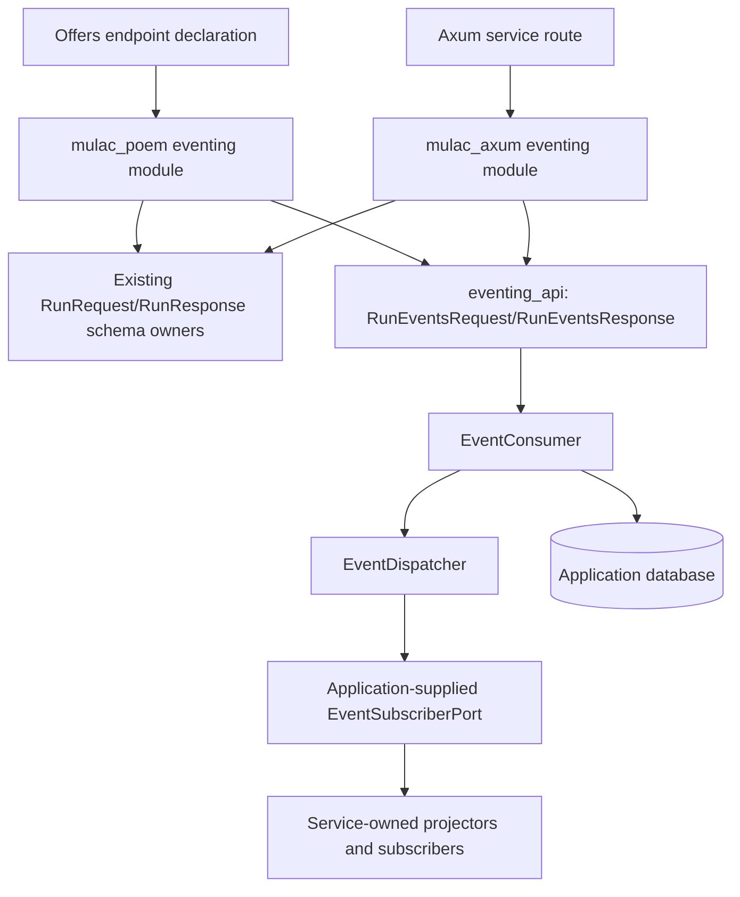

# Mulac eventing API adapters implementation plan

Status: Implemented, except the deferred steps listed in
[Implementation notes](#implementation-notes).

## Objective and scope

Implement Mulac's empty `libs/eventing_api` crate and add eventing support to
the existing Poem and Axum adapter crates. Then reduce offers' event queue
endpoint to a declaration and a delegation call. Both adapters use the same
validation and execution logic, as the inbox endpoints already do.

This covers `POST /events/run`, mounted under `/api` in offers. Offers'
`QueueApi` (`services/offers/src/orchestration/api.rs`) implements it today,
alongside `/commands/run` and `/outbox/run`. Those two endpoints belong to the
parallel commanding and outbox plans (`docs/offers-commanding-api-plan.md`,
`docs/offers-outbox-api-plan.md`). This plan leaves them unchanged. The agreed
delivery order is commanding, then eventing, then outbox (section 10).

Out of scope:

- Event recording and `EventGateway`.
- The stale-reservation sweep (`EventSweeper`).
- Background workers (`kernel::io::run_event_worker`).
- Subscriber registration.
- Retailer sourcing's own `/events/run` (`services/retailer_sourcing/src/platform/bus_api.rs`).

The implementation targets the Mulac checkout referenced by offers:
`/home/nulllabs/work/bodul/mulac`. At the time of writing, Mulac's head commit
`303300d` added `libs/eventing_api` as a placeholder crate with no
dependencies. It is already listed in `libs/Cargo.toml` and in the Makefile's
`NEW_LIBS`.

In this document, names marked *proposed* do not exist yet. All other paths,
types and functions exist in the two checkouts today.

## 1. Establish the crate boundaries

| Location | Responsibility |
| --- | --- |
| `libs/eventing_api` (exists, empty) | Framework-free run operation over an application-supplied `EventConsumer`, typed errors, optional Tokio execution, test fixtures |
| `libs/eventing_api` run types (*proposed*) | Its own framework-free `RunEventsRequest`/`RunEventsResponse`, copied from `inbox_api`'s run types (section 3) |
| `libs/mulac_poem` (exists) | New private `eventing` module behind the opt-in `eventing` feature: Poem `EventingAdapter` (*proposed*) that reuses the existing schema-owning `RunRequest`/`RunResponse` wrappers and converts them |
| `libs/mulac_axum` (exists) | New private `eventing` module behind the opt-in `eventing` feature: Axum `EventingAdapter`, extractor and response types (*proposed*), reusing the existing Utoipa schema twins |

Reservation, dispatch, retry scheduling and the attempt limit stay in the
existing `mulac-eventing` crate (`libs/eventing`). Routing one event to many
subscribers stays in the kernel's `EventSubscriberRegistry`.



Each crate keeps exposing only `pub mod io`, following Mulac's `AGENTS.md`. The
new modules (`contract`, `error`, `service`, `runtime`, `testing` in
`eventing_api`, and `eventing` in each adapter) are private and re-exported
through `io`. `eventing_api` does not depend on either framework or on the
kernel.

### Decision: extend the existing adapter crates

Add eventing to `mulac_poem` and `mulac_axum`. Do not create new
`mulac_poem_eventing`/`mulac_axum_eventing` crates.

- **One schema owner per framework.** poem-openapi 5.1.16 panics when two
  different Rust types register the same OpenAPI name. See
  `Registry::create_schema` in `poem-openapi-5.1.16/src/registry/mod.rs`: "`{}`
  and `{}` have the same OpenAPI name `{}`". Today `RunRequest`/`RunResponse`
  register through the schema twins in `mulac_poem/src/types.rs`. An eventing
  crate with its own twins would panic when offers builds its spec. Keeping
  eventing in `mulac_poem` lets it reuse the one existing wrapper pair, which
  converts into `eventing_api`'s own types (section 3).
- **Framework isolation is already enforced per crate.** The Makefile's `ci`
  target checks that `mulac_poem` never pulls Axum or Utoipa and that
  `mulac_axum` never pulls Poem or requires Utoipa. The new modules are covered
  without new rules.
- **Fewer crates to publish.** Three queue APIs times two frameworks would add
  up to six adapter crates to the `publish` and `pack_and_publish` lists.
- **ADR-009 frames the crates as framework adapters**, not as inbox adapters.
  The README and lib docs need rewording, not restructuring.

Gate eventing behind an opt-in, non-default cargo feature. All three queue
plans use the same scheme, with features named `commanding`, `eventing` and
`outbox`. Each feature enables its private module and its optional `*_api`
dependency:

```toml
# libs/mulac_poem/Cargo.toml (proposed; mulac_axum mirrors it)
[features]
default = ["diesel"]                       # unchanged; no queue feature
diesel = ["inbox_api/diesel"]              # unchanged; eventing_api has no diesel feature
eventing = ["dep:eventing_api"]

[dependencies]
eventing_api = { workspace = true, features = ["tokio"], optional = true }
```

```rust
// libs/mulac_poem/src/lib.rs (proposed)
#[cfg(feature = "eventing")]
mod eventing;
```

Applications without the feature compile none of the eventing code. Offers
turns it on explicitly with `features = ["eventing"]` (section 7). The
adapters' `diesel` feature does not change, because `eventing_api` has no
`diesel` feature (section 4). `inbox_api` stays a non-optional dependency of both adapters,
because the schema-owning `RunRequest`/`RunResponse` wrappers wrap its types.

### Decision: subscribers stay application-owned

`EventDispatcher::new` takes one `Arc<dyn EventSubscriberPort>`
(`libs/eventing/src/dispatcher.rs`). Fan-out by event type and subscriber name
is implemented by `kernel::io::EventSubscriberRegistry`
(`kernel/src/event_subscriber_registry.rs`). The kernel builds it in
`KernelBuilder::start_persistent` from `.event_subscriber(...)`,
`.event_subscriber_with_command_gateway(...)` and `.outbox_subscriber(...)`
registrations.

`eventing_api` receives a ready `EventConsumer` and never sees subscriber
names, event types or projectors. The service decides which subscribers exist.
Offers keeps registering its projectors and the `customer_facing` subscriber in
`start_mulac` (`services/offers/src/main.rs`).

`eventing_api` must not depend on the kernel to reach the registry, and it
assembles no storage. Its only constructor takes an `Arc<EventConsumer>` that
the application has built, from the kernel or from its own storage and
`EventDispatcher` (section 4).

Services continue to own paths, authentication, middleware, database
configuration, migration execution, subscriber registration and server
lifecycle.

## 2. Freeze the existing HTTP contract

Current behaviour, as implemented by `QueueApi::run_events` and
`QueueApi::run` in `services/offers/src/orchestration/api.rs`:

- The handler takes `Json<mulac_poem::io::RunRequest>`.
- It runs
  `RunResponse::from_result(consumer.consume(&ReservableEventSpec::new(request.limit)))`
  inside `tokio::task::spawn_blocking`.
- It maps a `JoinError` through `err_queue_task_failed()`.
- The limit is validated during Poem parsing: `parse_run_request` in
  `libs/mulac_poem/src/types.rs` calls `inbox_api::io::RunRequest::validate`.

Before extraction, extend characterization tests where the current behaviour is
not already covered.

| Case | Required behaviour | Source / existing coverage |
| --- | --- | --- |
| Limit bounds | Required integer from `1` through `1000` | `RunRequest::MIN_LIMIT`/`MAX_LIMIT` in `libs/inbox_api/src/contract.rs`; `queue_routes_validate_requests_and_report_failures` in `src/main.rs` |
| Invalid limit | `400` for `{}`, `0`, `1001`, `-1`, `1.5`, `"1"` | Same offers test |
| Additional invalid bodies | `400` for `{"limit":null}`, `{"limit":1.0}` and `[]` | Covered for `/inbox/run` only (`inbox_run_accepts_limit_bounds_and_unknown_fields`, `testing::invalid_run_requests`); **add for `/events/run`** |
| Malformed JSON | `400` for body `{` | Offers queue test |
| Out-of-range message | Poem `400` whose text wraps `limit must be between 1 and 1000` (`InboxApiError::LimitOutOfRange`) in poem-openapi's `parse request payload error: {reason}` | **Add an exact-text assertion** before replacing the parser |
| Unknown fields | `{"limit":1,"extra":true}` accepted | Inbox only; **add for events** |
| Content type | `415` when missing or `text/plain` | Inbox only (`inbox_routes_require_json_content_type`); **add for events** |
| Successful batch | `200`, `{"processed":N,"errors":[]}`, including `N=0` | `run_queue` helper in `src/postgres_tests.rs` |
| Consumer failure | `200`, `{"processed":null,"errors":[...]}`, with `EventError` display text such as `storage error: …` | Offers queue test against the unreachable test pool |
| Subscriber failure | `200`, `processed: null`, the subscriber's error in `errors`; the row is marked failed through `EventProcessPort::failed` with `ReservableEventSpec::DEFAULT_MAX_ATTEMPTS` (`6`) | `EventConsumer::process_entry`; **add a PostgreSQL test**, for example an `OfferCreated` event without metadata, which `CustomerFacingSubscriber` rejects |
| Partial batch failure | Successful entries stay completed | `EventConsumer::consume`; covered by the PostgreSQL subscriber-failure test above |
| Event type without subscribers | Completed and counted, because `EventSubscriberRegistry::handle` iterates an empty list | Kernel behaviour; document, do not change |
| Batch limit | Processes at most `limit` due events from this queue only | `queue_endpoints_process_one_stage_and_preserve_unavailable_outbox` |
| Blocking-task failure | `500`, text `queue processing task failed` | `err_queue_task_failed` in `api.rs`; **no events test today**; add one with a panicking service after the fixture exists (section 8) |
| OpenAPI | `/events/run` documented; request `RunRequest` with `minimum` 1 and `maximum` 1000; response `RunResponse` | `openapi_spec_matches_routes` in `src/main.rs` |

Preserve the error strings exactly. `queue processing task failed` is already
the display text of `InboxApiError::RunTaskFailed`, so offers and Mulac agree
today. Batch responses continue to expose consumer error messages verbatim.
Changing that policy would be a separate behaviour change.

As in the inbox extraction, framework-generated wording for malformed JSON does
not need to match across Poem and Axum. Statuses, accepted inputs, response
shapes and Mulac-defined messages must match.

## 3. Implement the shared eventing API

### Run types: one copy per API crate

`inbox_api::io::RunRequest`/`RunResponse` define the framework-free run
contract today. `eventing_api` must not depend on `inbox_api`, because that
would pull in `mulac-inbox` and `mulac-commanding` for event processing. Each
`*_api` crate therefore defines its own run types. The commanding and outbox
plans follow the same rule, with `RunCommandsRequest`/`RunCommandsResponse` and
`RunOutboxRequest`/`RunOutboxResponse`. `inbox_api` does not change, so there is
no breaking change.

`eventing_api` adds (*proposed*):

- `RunEventsRequest { limit: usize }` with `MIN_LIMIT = 1`, `MAX_LIMIT = 1000`,
  `from_json` and `validate`. These are copied from `inbox_api`'s `RunRequest`
  (`libs/inbox_api/src/contract.rs`), including Serde's strict integer parsing
  and ignored unknown fields.
- `RunEventsResponse { processed: Option<usize>, errors: Vec<String> }` with
  `from_result`, copied from `RunResponse::from_result`.

These types have no OpenAPI schema of their own. The published schema names
stay with each framework's existing schema-owning pair:

- Poem: the wrappers `mulac_poem::io::RunRequest`/`RunResponse`
  (`mulac_poem/src/types.rs`). The eventing module converts the wrapper into
  `RunEventsRequest` and `RunEventsResponse` back into the wrapper (section 5).
- Axum: the existing private twins `twins::RunRequest`/`twins::RunResponse`
  (`mulac_axum/src/schema.rs`), reported by the eventing extractor and response
  types (section 6).

The published OpenAPI therefore keeps exactly one `RunRequest` and one
`RunResponse` schema, so the poem-openapi duplicate-name panic (section 1)
cannot occur.

**Accepted trade-off:** the limit bounds, the `limit must be between 1 and
1000` string and the `from_result` mapping exist in four `*_api` crates. Shared
test fixtures guard against drift (section 8). Every `*_api` crate's `testing`
module exposes the same run-request table, and each crate's tests run it.

### Eventing API types

Add these to `eventing_api`, following `libs/inbox_api`:

| Proposed type | Purpose |
| --- | --- |
| `RunEventsRequest`, `RunEventsResponse` | Framework-free run types (above) |
| `EventingApiError` | Typed validation and execution failures |
| `EventingService` | Synchronous batch operation over an `Arc<EventConsumer>` |
| `AsyncEventingService` | Optional Tokio wrapper (feature `tokio`) |
| `testing` module | Fixtures and port doubles (feature `testing`) |

`EventingApiError` variants and display strings:

| Proposed variant | Display | Client error |
| --- | --- | --- |
| `MalformedRequest(String)` | the Serde message | yes |
| `LimitOutOfRange { limit, min, max }` | `limit must be between {min} and {max}` | yes |
| `RunTaskFailed(Cause)` | `queue processing task failed` | no |

Provide `is_client_error()`. Construct every error in a named `err_*` helper
(`err_malformed_request`, `err_limit_out_of_range`, `err_run_task_failed`), as
`libs/inbox_api/src/error.rs` does. Keep the
`JoinError` as `source()` rather than discarding it as `err_queue_task_failed`
does today.

Implement `EventingService::run` in this order:

1. Validate the request with `RunEventsRequest::validate`, so direct callers get the
   same check as HTTP callers.
2. Build `ReservableEventSpec::new(request.limit)`, keeping
   `DEFAULT_MAX_ATTEMPTS` (`6`).
3. Call `EventConsumer::consume`.
4. Return `RunEventsResponse::from_result(result)`. Consumer failures are part of a
   successful response, not an error.

Implementation requirements:

- Do not add a public way to override `max_attempts` in this extraction. That
  would change the contract.
- Leave reservation, dispatch, completion and failure marking, retry
  scheduling and transactions in `mulac-eventing`.
- Keep validation independent of framework extraction.

## 4. Centralize runtime and construction code

Enable Tokio through an optional `tokio` feature on `eventing_api`, which
depends on `tokio` with `rt` only, as `inbox_api` does. Both adapters enable it.
`AsyncEventingService::run` owns the `spawn_blocking` call that
`QueueApi::run` repeats today. It maps `JoinError` to
`EventingApiError::RunTaskFailed`. It uses the caller's runtime and creates no
runtime, pool or worker.

There is one construction path (*proposed* signatures):

```rust
// Explicit consumer: the kernel's, a test double, or custom storage.
EventingService::new(consumer: Arc<EventConsumer>)

// Async wrapper (feature `tokio`), as in inbox_api.
AsyncEventingService::from(EventingService::new(consumer))
```

Offers passes `kernel.event_consumer()`.
`PersistentKernelHandle::event_consumer()` already returns the consumer whose
dispatcher holds the full registry. That registry includes
`event_subscriber_with_command_gateway` factories and the reserved `outbox`
no-op subscribers, so no second assembly can drift from it.

This extraction has no PostgreSQL convenience constructor (no
`from_postgres`). `eventing_api` takes no pool, so it needs neither a `DbPool`
re-export from `eventing::io` nor a `mulac_diesel` dependency. A kernel-free
constructor that takes a pool and an `Arc<dyn EventSubscriberPort>` can be
added later behind a new optional feature without breaking anything.

### Feature and Diesel audit

| Crate | Current features (verified) | Effect |
| --- | --- | --- |
| `mulac-eventing` | `default = ["diesel"]`, `diesel = ["dep:diesel", "dep:mulac_diesel"]` | `cargo tree -p mulac-eventing --no-default-features -e normal` contains no `diesel` |
| `mulac-commanding` | `diesel` forwards `eventing/diesel`; depends on eventing with `default-features = false` | Diesel only when requested |
| `mulac-inbox` | `diesel` forwards `commanding/diesel`; `amqp` implies `diesel` | Diesel only when requested |
| `inbox_api` | `default = ["diesel"]`; workspace entry sets `default-features = false` | `--no-default-features` tree has no `diesel` |
| `mulac_poem`, `mulac_axum` | `default = ["diesel"]` | `--no-default-features` trees have no `diesel`; the new `eventing` feature stays out of `default` and forwards no Diesel feature |
| `mulac-kernel` | depends on `inbox` with `features = ["diesel"]` unconditionally | Any kernel user, including offers, always builds Diesel; this is expected and outside this plan |

`eventing_api` needs no `diesel` feature. Everything it uses is ungated in
`libs/eventing/src/lib.rs`: `EventConsumer`, `ReservableEventSpec`,
`EventError`, `EventEnvelope`, `EventDispatcher` and the `EventReservePort`,
`EventProcessPort` and `EventSubscriberPort` ports. Only
`EventConsumerStorage`, `EventStoreStorage`, `EventEntry` and `NewEventEntry`
are behind `diesel`, and `eventing_api` uses none of them. Its whole dependency
tree is therefore Diesel-free in every feature combination.

Proposed `eventing_api` manifest:

```toml
[features]
default = []
tokio = ["dep:tokio"]
testing = []

[dependencies]
eventing = { path = "../eventing", version = "0.3.0", registry = "margo", default-features = false, package = "mulac-eventing" }
serde.workspace = true
thiserror.workspace = true
tokio = { workspace = true, features = ["rt"], optional = true }
```

Requirements:

- Every Mulac dependency of `eventing_api` and the adapters must use
  `default-features = false`. A single default-on edge, such
  as a dev-dependency leaking into `-e normal` or a workspace entry without
  `default-features = false`, re-enables Diesel through feature unification.
- Add an `eventing_api` workspace dependency entry with
  `default-features = false`, like the existing `inbox_api` entry.
- Extend the Makefile `ci` boundary checks:
  - `cargo tree -p eventing_api --all-features -e normal` must not contain
    `diesel`.
  - `cargo tree -p mulac_poem --no-default-features --features eventing -e normal`
    and the `mulac_axum` equivalent must not contain `diesel`.
  - The default build of each adapter must not include the feature:
    `cargo tree -p mulac_poem -e normal` (and `mulac_axum`) must not contain
    `eventing_api`.
  - Each feature builds alone: `cargo clippy -p mulac_poem --no-default-features
    --features eventing -- -D warnings`, and the same for `mulac_axum`. The
    existing `--all-features` and `--no-default-features` runs cover the
    combined and empty builds. Run the same loop for `commanding` and `outbox`
    once those plans land.

Document that dropping an HTTP request does not stop a batch that has already
started on the blocking pool.

## 5. Implement the Poem adapter

`mulac_poem` gains a private `eventing` module behind the `eventing` feature,
re-exported from `io`:

- `EventingAdapter` (*proposed*), backed by `AsyncEventingService`, cloneable.
- `EventingAdapter::run(&self, request: Json<RunRequest>) ->
  Result<Json<RunResponse>>`, using the existing wrappers in
  `mulac_poem/src/types.rs`. It converts `request.0.limit` into
  `RunEventsRequest` and `RunEventsResponse` into `RunResponse`, through
  private `From` impls in the eventing module.
- An error helper mapping `EventingApiError` to `400` for client errors and
  `500` otherwise, mirroring `err_inbox_failed` in
  `mulac_poem/src/adapter.rs`.

No new OpenAPI types are needed. Offers' `/events/run` already uses
`mulac_poem::io::RunRequest` and `RunResponse`. The wrappers keep wrapping
`inbox_api`'s types, and their schema twins and names do not change.

Limit validation stays in `RunRequest`'s `ParseFromJSON`, so the 400 response
and its `parse request payload error: …` wording stay as they are.
`EventingService::run` validates again for direct callers. That second check is
unreachable over HTTP.

Offers declares the endpoint as follows. The adapter type and field are
*proposed*:

```rust
#[OpenApi]
impl EventingApi {
    /// Dispatch one batch of due events to the registered projectors.
    #[oai(path = "/events/run", method = "post")]
    async fn run_events(&self, request: Json<RunRequest>) -> Result<Json<RunResponse>> {
        self.adapter.run(request).await
    }
}
```

Keep the doc comment so the OpenAPI summary is unchanged. Add a
`poem_eventing` example (*proposed*) that boots a kernel, registers one
subscriber and mounts the route. Gate it with `required-features =
["eventing"]`. The kernel is a dev-dependency of the example only.

## 6. Implement the Axum adapter

`mulac_axum` gains a private `eventing` module behind `eventing`:

- `EventingAdapter` (*proposed*): cloneable router state backed by
  `AsyncEventingService`.
- `RunEvents` (*proposed*): an extractor that reads a JSON `Value` with Axum's
  `Json` extractor and delegates to `RunEventsRequest::from_json`. It follows the
  same pattern as `RunInbox` in `mulac_axum/src/extract.rs`.
- `EventsRunResponse` (*proposed*): `200` JSON wrapping `RunEventsResponse`.
- `EventingHttpError` (*proposed*): plain-text `IntoResponse`. It normalizes
  `JsonRejection::JsonDataError` to `400` and passes content-type and
  body-limit rejections through, as `InboxHttpError` does.

Extract the rejection normalization into a private helper shared by
`InboxHttpError` and `EventingHttpError`. Axum's 422-to-400 rule then lives in
one place.

The intended integration (*proposed* types):

```rust
async fn run_events(
    State(events): State<EventingAdapter>,
    request: RunEvents,
) -> Result<EventsRunResponse, EventingHttpError> {
    events.run(request).await
}

let event_routes = Router::new()
    .route("/events/run", post(run_events))
    .with_state(EventingAdapter::new(EventingService::new(kernel.event_consumer())));
```

With `utoipa` enabled, implement `ToSchema` for `RunEvents` and
`EventsRunResponse` with the existing private twins `twins::RunRequest` and
`twins::RunResponse` in `mulac_axum/src/schema.rs`. Do not add new twins. The
components then contain one `RunRequest` and one `RunResponse` whichever
queues an application mounts. Extend the `axum_openapi` example with the events
path, and add an `axum_eventing` example (*proposed*) without `utoipa`.

## 7. Integrate offers

| File | Change |
| --- | --- |
| `Cargo.toml` | Add `eventing_api`, plus `eventing_api` with `testing` in `[dev-dependencies]`. Enable the opt-in feature on `mulac_poem` (`features = ["eventing"]`). Before this stage merges, all of offers' Mulac dependencies move from local `path` to `git = "https://github.com/nulllabsdev/mulac", branch = "wip/inbox-api"`, and the commented `tag = "0.3.0"` lines are removed. There are no release tags |
| New `src/orchestration/eventing_api.rs` (*proposed*) | `EventingApi` with the single `/events/run` declaration and delegation, and route-level tests, mirroring `src/orchestration/inbox_api.rs` |
| `src/orchestration/api.rs` | Remove `run_events` and the `ReservableEventSpec` import. `QueueApi`, its `run` helper and `err_queue_task_failed` remain while `/commands/run` or `/outbox/run` still live there |
| `src/orchestration/mod.rs` | Declare `pub mod eventing_api;` and `pub use eventing_api::EventingApi;`; update the module doc |
| `src/main.rs` | In `start_mulac`, build `EventingAdapter::new(EventingService::new(kernel.event_consumer()))` and store it in a new `AppState` field `events` (*proposed*). Register `EventingApi::new(state.events)` in the `OpenApiService` tuple in `app_with_reporting_token` |
| `src/postgres_tests.rs` | No setup change, because the `run_queue` helper exercises HTTP. Add the subscriber-failure characterization from section 2 |
| `README.md` | State that Mulac owns `/events/run` behaviour, that `src/orchestration/eventing_api.rs` only declares it, and that subscribers stay registered in `start_mulac` |
| `bruno/offers/run-events.bru` | No change; the path and body are unchanged |

Subscriber assembly does not move. `RetailerOfferProjector`,
`RetailerOfferIdentifiersProjector` and `CustomerFacingSubscriber` remain
registered through `kernel::boot(...).event_subscriber(...)` in `start_mulac`.
With the agreed order, commanding lands first, so `QueueApi` holds only
`/outbox/run` once this plan lands. `AppState.kernel` stays only if something
else still uses it; the outbox plan removes what remains.

Add the missing route tests from section 2 to `eventing_api.rs`: 415, the
extra invalid bodies, unknown fields and the exact 400 text. Add a task-failure
test that replaces `state.events` with
`EventingAdapter::new(eventing_api::io::testing::panicking_service())` and
asserts `500` with `queue processing task failed`. This is the same pattern as
`inbox_sanitizes_blocking_task_failures`. Keep `events` in the shared loops in
`queue_routes_validate_requests_and_report_failures` and
`openapi_spec_matches_routes`.

## 8. Build a shared verification suite

| Test layer | Coverage |
| --- | --- |
| `eventing_api` run types | Bounds, strict integer parsing, unknown fields, `from_result` shapes, display strings, using the same bodies as `inbox_api`'s run fixtures |
| `eventing_api` service | Empty batch, successful dispatch count, reservation failure, subscriber failure with failure marking, partial success, limit validation for direct callers |
| Tokio wrapper | Runs on the blocking pool; panics become `queue processing task failed` with a `source()` |
| Poem HTTP | Statuses, bodies, malformed JSON, 415, exact Mulac messages, OpenAPI names and bounds; a spec containing both inbox and eventing routes builds without the duplicate-name panic |
| Axum HTTP | The same contract, 422-to-400 normalization, preserved 415 and 413, router state composition, Utoipa components with one `RunRequest` |
| PostgreSQL (offers) | `run_queue` sequences, projections, subscriber failure scheduling a retry, one-stage-per-endpoint |
| Offers integration | inbox -> commands -> events -> `read_offers`/`read_offer_identities` (`inbox_submission_processes_offer_through_all_http_stages`) |

Proposed `eventing_api::io::testing` fixtures. They use existing ports
(`EventReservePort`, `EventProcessPort`, `EventSubscriberPort`), so no database
is needed:

- `recording_service()`: a queue double that yields given envelopes, and a
  subscriber that records event types.
- `failing_reservation_service()` with
  `RESERVATION_FAILURE = "storage error: reservation unavailable"`. This is the
  `EventError::Storage` display text and the same string as
  `inbox_api::io::testing::RESERVATION_FAILURE`.
- `failing_subscriber_service()`: asserts that `failed` is called with
  `max_attempts == 6`.
- `panicking_service()`.

Shared drift fixtures: `eventing_api::io::testing` exposes the same run-request
table as every other `*_api` crate:

- `invalid_run_requests()`, copied from `inbox_api::io::testing::invalid_run_requests`.
- `valid_run_requests()`, copied from `inbox_api::io::testing::valid_run_requests`,
  including the bounds `{"limit":1}` and `{"limit":1000}`, plus
  `{"limit":1,"extra":true}`.
- Proposed `run_request_error_messages()`: the expected error strings for those
  bodies, including `limit must be between 1 and 1000`.

`eventing_api`'s own tests run the table against `RunEventsRequest`. Both
adapter crates' tests run it over HTTP, so both frameworks pass one contract
and the four copies cannot drift unnoticed. Adapter tests also assert that a
spec mounting inbox and eventing routes together builds without the poem-openapi
panic.

## 9. Update documentation, CI and packaging

- No ADR work in this plan. The commanding stage writes Mulac ADR-010
  (*proposed*) in full. It covers all three extractions up front, including
  eventing's per-crate run types and application-owned subscribers. The
  eventing stage adds no ADR and does not edit ADR-010 or the accepted ADR-009.
- Replace `libs/eventing_api/README.md`'s "It has no code yet" with the crate's
  purpose, features and construction paths. Update the `mulac_poem` and
  `mulac_axum` READMEs and lib docs, which currently describe them as inbox
  adapters.
- `libs/Cargo.toml`: `eventing_api` is already a member. Add an
  `eventing_api` workspace dependency entry with `default-features = false`.
- Makefile: `NEW_LIBS` already lists `eventing_api`. Add the boundary and
  feature checks from section 4. Add `eventing_api` to `publish` and
  `pack_and_publish` after `mulac-eventing` and before `mulac_poem` and
  `mulac_axum`, which must come after every `*_api` crate they depend on.
- Monorepo: update `services/offers/README.md`. No monorepo ADR is needed
  unless offers' framework choice changes; it does not.

Verification during implementation:

- Run `make fmt` first, then Mulac `make ci`. It covers format, clippy (deny
  warnings for `NEW_LIBS` with all and with no default features), tests and
  dependency boundaries.
- Run offers' `make ci` and `make test-postgres`.
- Run offers with `PORT=<port> make serve`. Check `/api/health`,
  `/api/openapi.json` (one `RunRequest` with bounds 1 and 1000) and
  `POST /api/events/run` with `{"limit":1}`.
- Run `make audit` in offers, because `Cargo.toml` and `Cargo.lock` change.
  Report new advisories.
- Push the matching Mulac stage to the `wip/inbox-api` branch before the
  offers stage merges. Offers must build against that git branch, not against a
  local path.

## 10. Deliver in reviewable stages

### Ordering with the commanding and outbox extractions

The agreed order is **commanding, then eventing, then outbox**.

- **Commanding first.** It writes ADR-010 in full for all three extractions and sets the patterns this
  plan copies: per-crate run types (`RunCommandsRequest`/`RunCommandsResponse`),
  conversion from the schema-owning wrappers, the `commanding` feature and its
  CI checks. This plan follows those conventions. Where the commanding plan
  settles a detail differently, such as conversion helper names or the
  feature-check loop, follow it.
- **No shared crate dependency.** `eventing_api` does not depend on
  `commanding_api` or `inbox_api`. `commanding_api` may depend on
  `mulac-commanding`, and through it on `mulac-eventing`, but not on
  `eventing_api`. Eventing only needs commanding to land first for conventions
  and the ADR, not for code.
- **Mulac branch.** Each Mulac stage is pushed to `wip/inbox-api` before the
  offers stage that depends on it merges. Offers' Mulac dependencies point at
  that branch by git.
- **Shared `QueueApi`.** Commanding removes `run_commands` from
  `services/offers/src/orchestration/api.rs`. This plan then removes
  `run_events`, leaving only `/outbox/run`. Outbox owns the only `503`
  (`err_outbox_not_configured`), moves the outbox test module, and deletes the
  remaining `QueueApi`, its `run` helper, `err_queue_task_failed`, and
  `AppState.kernel` if nothing else uses it.
- **Adapter features.** `commanding`, `eventing` and `outbox` are separate
  opt-in features in both adapter crates. Each touches only its own module, so
  the plans' adapter diffs do not overlap except in `lib.rs`, `Cargo.toml` and
  the Makefile check loop.
- **Error strings.** `queue processing task failed` and `limit must be between
  1 and 1000` stay identical in every `*_api` error type.

### Stages

1. Characterization tests in offers (section 2). There is no ADR work, because
   ADR-010 already exists from the commanding stage.
2. `eventing_api`: `RunEventsRequest`/`RunEventsResponse`, errors,
   `EventingService::new`, `AsyncEventingService`, the shared run-request
   fixtures, port doubles and feature checks.
3. The Poem `eventing` module (opt-in feature) with wrapper conversion,
   contract and schema tests.
4. The Axum `eventing` module (opt-in feature) with contract tests and optional
   Utoipa schemas.
5. Push Mulac stages 2 to 4 to `wip/inbox-api`. Then do the offers migration:
   point the git dependency at that branch, enable the feature, add the
   `EventingApi` file, `AppState`, registration, tests and README.
6. Packaging, publish lists and final documentation.

## Completion criteria

- Both frameworks pass the shared eventing contract fixtures.
- Offers' `/events/run` is a single declaration delegating to
  `mulac_poem::io::EventingAdapter`. Subscribers are still registered only in
  `start_mulac`.
- Statuses, response shapes, the `1..=1000` limit bounds,
  `queue processing task failed`, consumer error texts and the published
  `RunRequest`/`RunResponse` schemas are unchanged.
- `eventing_api` and the adapters build without Diesel when default features
  are disabled. The `eventing` feature builds alone and is absent from the
  adapters' default build. CI enforces all three.
- `inbox_api` is unchanged.
- Mulac `make ci`, offers' `make ci`, `make test-postgres` and the
  `PORT=<port> make serve` check pass, with any new advisories reported.

## Decided

- Each `*_api` crate has its own run types, `RunEventsRequest`/`RunEventsResponse`
  here. There is no shared run crate and `inbox_api` is unchanged. The
  duplication is accepted and guarded by shared test fixtures.
- Opt-in, non-default `commanding`, `eventing` and `outbox` features in
  `mulac_poem` and `mulac_axum`. Offers enables `eventing`.
- No `EventingService::from_postgres` in this extraction. There is no pool, no
  `DbPool` re-export and no `diesel` feature on `eventing_api`.
- One Mulac ADR-010, written in full by the commanding stage. Eventing adds none.
- There are no Mulac release tags. Offers uses
  `git = "https://github.com/nulllabsdev/mulac", branch = "wip/inbox-api"`,
  and each Mulac stage is pushed there first.
- Delivery order: commanding, then eventing, then outbox.

## Open questions

1. Conversion helper names and the Makefile feature-check loop should match
   whatever the commanding plan, which lands first, settles on. Re-check this
   plan against it before implementation.

## Implementation notes

Deviations from the plan, recorded during implementation. The commanding
stage's conventions (`docs/offers-commanding-api-plan.md`, "Implementation
notes") were followed where this plan differs.

- **Consumer failure text.** Against an unreachable database the kernel's
  event consumer reports `reservation error: …`, not `storage error: …`
  (section 2). The offers characterization test pins the
  `reservation error: ` prefix, as the commanding tests do.
- **`kernel` fields.** `run_events` was the only reader of `QueueApi.kernel`
  and `AppState.kernel`, so both were removed in this stage instead of the
  outbox stage (sections 7 and 10); leaving them fails the dead-code lint.
  `QueueApi::new` now takes only the outbox consumer, and `start_mulac` still
  returns the kernel handle for shutdown.
- **Dependencies.** `eventing_api` depends on `serde_json` for
  `RunEventsRequest::from_json`, which the proposed manifest (section 4)
  left out. Its `testing` feature enables an optional `uuid` dependency,
  because the port signatures and `EventEnvelope` use `Uuid`.
- **Test doubles.** `testing` exposes `empty_service()`,
  `queued_service(n)`, `recording_service(&[event types])` (returns the
  service and the list of handled event types),
  `failing_reservation_service()`, `failing_subscriber_service()`,
  `failing_subscriber_and_process_service()`, `partially_failing_service()`
  (returns the service and a completion counter) and `panicking_service()`,
  with the constants `RESERVATION_FAILURE`
  (`storage error: reservation unavailable`, as planned),
  `SUBSCRIBER_FAILURE` and `PROCESS_FAILURE`. The process double asserts that
  every `failed` call uses `ReservableEventSpec::DEFAULT_MAX_ATTEMPTS`. The
  run-request table is copied verbatim from `commanding_api`.
- **Poem conversions.** `From<RunRequest> for RunEventsRequest` and
  `From<RunEventsResponse> for RunResponse` in `mulac_poem`'s `eventing`
  module; error conversion is the named helper `err_eventing_failed`.
- **Axum.** The shared `body` module from the commanding stage already holds
  the `422`-to-`400` normalization (section 6), so `eventing.rs` only reuses
  it. The Utoipa schema tests share a private `assert_queues_share_run_schemas`
  helper, which the commanding test now uses too.
- **Examples.** Following the commanding stage, there is no `poem_eventing`
  example (Mulac's `libs` workspace cannot depend on the kernel) and
  `axum_openapi` is unchanged. The Axum examples are `axum_eventing` and
  `axum_eventing_openapi`, using `eventing_api`'s `testing::queued_service`.
- **Makefile.** `eventing` joined the commanding stage's
  `ADAPTER_FEATURES` loop. Its `*_api` Diesel check uses
  `--no-default-features --features tokio` rather than `--all-features`
  (section 4); for `eventing_api` both cover the same dependencies.
- **Offers tests.** The characterization tests in
  `src/orchestration/eventing_api.rs` (shared run-request table, exact Poem
  limit message, `415`, OpenAPI summary, `$ref`s and the single `200`) were run
  against the old `QueueApi::run_events` first. The sanitized `500` test was
  added with the migration. The published OpenAPI document was compared before
  and after the migration and is byte-identical. The PostgreSQL case is
  `events_run_reschedules_subscriber_failures_and_keeps_completed_events`: it
  covers the subscriber failure, the retry backoff, a completed event without
  subscribers in the same batch, and no outbox row. It checks one attempt;
  dead-lettering after six attempts is the same `mulac-eventing` logic and is
  not repeated.

Deferred by decision during implementation:

- Mulac changes were not pushed to `wip/inbox-api`, and offers keeps its local
  `path` dependencies on Mulac instead of the `git` source (sections 7, 9, 10
  and "Decided").
- `make test-postgres` and `PORT=<port> make serve` were not run, because no
  database is configured for offers.
