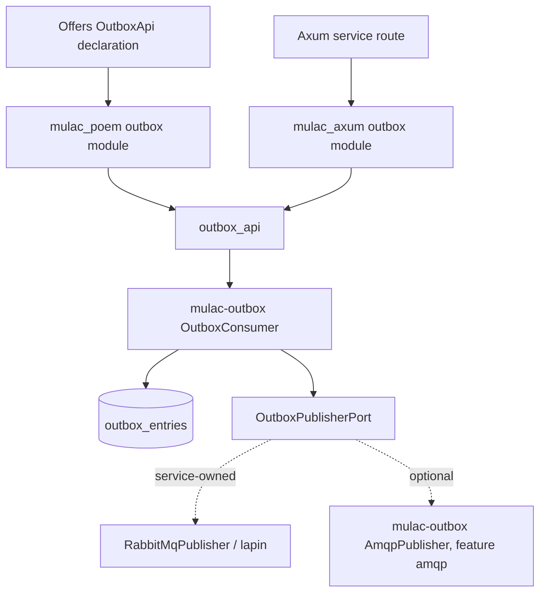

# Mulac outbox API adapters implementation plan

Status: Stages 1–10 implemented. See "Implementation notes".

## Objective and scope

Implement Mulac's `libs/outbox_api` skeleton and add outbox support to the
existing Poem and Axum adapters. Then reduce offers' outbox endpoint to a
declaration and a delegation call. Both adapters use the same validation and
execution logic, following the inbox extraction recorded in Mulac's
[ADR-009](../../mulac/docs/adr/009-inbox-http-adapters.md).

This plan covers only `POST /outbox/run`, mounted under `/api` in offers. It
publishes one batch of due `outbox_entries` rows through a publisher. The
`/commands/run` and `/events/run` endpoints are covered by the sibling plans
[`offers-commanding-api-plan.md`](offers-commanding-api-plan.md) and
[`offers-eventing-api-plan.md`](offers-eventing-api-plan.md). Outbox recording,
which is offers' `subscribers::customer_facing` subscriber, and the stale
reservation sweep keep their current behavior.

The implementation targets the Mulac checkout that offers references:
`/home/nulllabs/work/bodul/mulac`.

### Current state

| Location | Today |
| --- | --- |
| `services/offers/src/orchestration/api.rs` | `QueueApi::run_outbox` returns `503` when `outbox` is `None`. Otherwise it runs `OutboxConsumer::publish_batch(&ReservableOutboxSpec::new(request.limit))` through `QueueApi::run` (`spawn_blocking`) and converts the result with `RunResponse::from_result` |
| `services/offers/src/orchestration/mod.rs` | `outbox_consumer(pool, publisher)` builds `OutboxConsumerStorage`, `OutboxConsumerRepository` and `OutboxConsumer` |
| `services/offers/src/orchestration/rabbitmq.rs` | `RabbitMqPublisher` implements `OutboxPublisherPort` with lapin. `from_env` reads `AMQP_URL` and `OUTBOX_EXCHANGE` |
| `services/offers/src/main.rs` | `AppState.outbox: Option<Arc<OutboxConsumer>>` is set only when `RabbitMqPublisher::from_env()` returns `Some` |
| `services/offers/src/orchestration/inbox_api.rs` | The finished inbox example: two endpoint declarations that delegate to `mulac_poem::io::InboxAdapter` |
| `mulac/libs/outbox_api` | Empty skeleton: no dependencies, only a placeholder test |
| `mulac/libs/outbox` (`mulac-outbox`) | `OutboxConsumer`, `ReservableOutboxSpec` (default `max_attempts` 6), `consumer_repository(pool)` behind `diesel`, `AmqpPublisher` behind `amqp` |

`QueueApi::run_outbox` already uses `mulac_poem::io::RunRequest` and
`RunResponse`, so the request parsing and the OpenAPI schemas already belong
to Mulac. What remains in offers is the "not configured" decision, consumer
assembly, the blocking-task wrapper, result conversion and error construction.

## 1. Establish the crate boundaries

| Location | Responsibility |
| --- | --- |
| `libs/outbox_api` (existing skeleton) | Framework-free batch contract for the outbox, `OutboxApiError`, a synchronous service, an optional Tokio wrapper, PostgreSQL assembly, test fixtures |
| `libs/mulac_poem`, proposed `outbox` module and feature | Poem `OutboxAdapter`, response and error conversion. Reuses the existing `RunRequest` and `RunResponse` wrappers |
| `libs/mulac_axum`, proposed `outbox` module and feature | Axum extractor, `OutboxAdapter`, `IntoResponse` conversions, optional Utoipa schemas |

Reservation, publication, completion, retry scheduling and dead-lettering stay
in `mulac-outbox`. Broker transports stay outside `outbox_api`; see section 4.



`outbox_api` exposes only `pub mod io`, as Mulac's `AGENTS.md` requires. It
depends on `mulac-outbox` with `default-features = false`. It does not depend
on an HTTP framework, the kernel, `inbox_api` or a broker client.

### Decision: extend the existing adapter crates

Put the outbox adapters in `mulac_poem` and `mulac_axum`, each in a private
`outbox` module behind an optional, non-default `outbox` feature. Do not add
`mulac_poem_outbox`/`mulac_axum_outbox` crates. The reasons:

- **OpenAPI schema names.** poem-openapi panics when two different Rust types
  register the same schema name. See `Registry::create_schema` in
  poem-openapi 5.1.16 (`src/registry/mod.rs`): "`A` and `B` have the same
  OpenAPI name". `mulac_poem`'s wrappers delegate registration to private
  schema twins in `src/types.rs` (`schema::RunRequest`, `schema::RunResponse`).
  Code inside `mulac_poem` can reuse those twins without a collision. A
  separate crate would need its own twins, and offers would panic when
  building `OpenApiService` with both. It would also need distinct names,
  which would change offers' published schema.
- **Neutral crate names.** The crate names are not inbox-specific, and
  ADR-009 describes them as the Poem and Axum adapters. The skeleton commit
  (`303300d`) reserved only the `*_api` crates, not new adapter crates.
- **Packaging.** No new crates need publishing. The commanding and eventing
  extractions can add sibling modules the same way.

This follows the gating decision that applies to all three plans: the
adapters get opt-in, non-default features named `commanding`, `eventing` and
`outbox`, each enabling one module. This plan adds `outbox`; the sibling plans
add `commanding` and `eventing`.

Inbox support stays ungated for now. `mulac_poem` and `mulac_axum` keep
depending on `inbox_api` unconditionally, so an outbox-only application still
compiles `inbox_api`, `mulac-inbox`, `mulac-commanding` and `mulac-eventing`.
That tree has no Diesel when `diesel` is off (verified with
`cargo tree -p mulac_poem --no-default-features`). This is an accepted cost of
the decision.

## 2. Freeze the existing HTTP contract

These are the current behaviors. Extend characterization tests where the last
column says "add" before changing any code.

| Case | Current behavior | Source | Coverage |
| --- | --- | --- | --- |
| Missing, `0`, `1001`, `-1`, `1.5`, `"1"` limit | `400` | `main.rs` `queue_routes_validate_requests_and_report_failures` | Covered (loops all four queues) |
| Malformed JSON `{` | `400` | same test | Covered |
| `limit` `null` or `1.0`; unknown fields | `400`; unknown fields ignored | `inbox_api.rs` `inbox_run_accepts_limit_bounds_and_unknown_fields` (same `RunRequest` type) | Add for `/outbox/run` |
| Missing or `text/plain` content type | `415` | `inbox_api.rs` `inbox_routes_require_json_content_type` (same type) | Add for `/outbox/run` |
| Invalid body while unconfigured | `400`, because body parsing runs before the handler | `main.rs` queue test (outbox unconfigured) | Covered |
| Valid body, publisher not configured | `503`, plain text `outbox publisher is not configured` | `api.rs` `err_outbox_not_configured`; asserted in `main.rs` | Covered |
| Unconfigured run leaves rows untouched | No reservation or attempt change | `postgres_tests.rs` `queue_endpoints_process_one_stage_and_preserve_unavailable_outbox` | Covered |
| Limit bounds `1` and `1000` | Accepted | `main.rs` queue test (returns `503` when unconfigured) | Add for a configured adapter |
| Successful batch | `200`, `{"processed":N,"errors":[]}`, including `N=0` | `postgres_tests.rs` `outbox_delivery_completes_only_confirmed_items_and_retries_failures` via `run_queue` | Covered |
| Reservation or storage failure | `200`, `{"processed":null,"errors":[…]}` | `api.rs` test `configured_outbox_reports_storage_failure` | Covered |
| Publication failure | `200`, `processed:null`, one error per item; row `attempts=1`, unreserved, scheduled later | `postgres_tests.rs` outbox delivery test | Covered |
| Partial batch | Confirmed items stay completed; failed items use Mulac's retry schedule | `OutboxConsumer::publish_batch` in `libs/outbox/src/outbox_consumer.rs` | Add an HTTP-level partial case |
| Blocking-task failure | `500`, `queue processing task failed` | `api.rs` `err_queue_task_failed` | Add (panicking consumer or publisher) |
| OpenAPI | `/outbox/run` uses `#/components/schemas/RunRequest` (`limit` minimum 1, maximum 1000) and `RunResponse` | `main.rs` `openapi_spec_matches_routes`; `mulac_poem/src/types.rs` | Extend to assert the `/outbox/run` `$ref`s and the `200` response |

Error strings inside `errors` come from `OutboxError`'s `Display`
(`libs/outbox/src/assembly/application.rs`), for example
`storage error: …`, and from offers' publisher helpers in `rabbitmq.rs`:

- `transport error: RabbitMQ connection or publication failed`
- `transport error: RabbitMQ publication timed out`
- `transport error: RabbitMQ publication requires the application runtime`
- `routing error: RabbitMQ returned an unroutable message`
- `publish error: RabbitMQ negatively acknowledged publication`
- `publish error: RabbitMQ did not confirm publication`

Keep these strings unchanged. As with the inbox, batch responses report
consumer error messages verbatim. Sanitizing them would be a separate behavior
change.

The `400` body for an out-of-range limit is Poem's parse error, which wraps
Mulac's `limit must be between 1 and 1000`. The request type does not change,
so this body stays the same by construction. Record its current text in a test
anyway.

## 3. Implement the shared outbox API

Proposed public items in `outbox_api::io`:

| Proposed type | Purpose |
| --- | --- |
| `RunOutboxRequest` | Serde batch request `{ limit }`, with `MIN_LIMIT = 1`, `MAX_LIMIT = 1000`, `from_json` and `validate` |
| `RunOutboxResponse` | `processed: Option<usize>`, `errors: Vec<String>`, `from_result` |
| `OutboxApiError` | Typed malformed-request, limit, not-configured and task failures |
| `OutboxService` | Synchronous `run` |
| `AsyncOutboxService` | Optional Tokio wrapper (feature `tokio`), including the unconfigured state |

### Request and response types: shared HTTP names, per-crate Rust types

This is decided for all three plans. Each framework-free crate owns its own
copy of the run types: `RunOutboxRequest`/`RunOutboxResponse` here, and
`RunCommandsRequest`/`RunCommandsResponse` and
`RunEventsRequest`/`RunEventsResponse` in the sibling plans. There is no
shared batch contract crate.

Offers registers one `RunRequest` and one `RunResponse` schema for all four
`/…/run` endpoints. Keep that:

- **HTTP layer (one schema owner per framework).** Poem keeps the existing
  `mulac_poem::io::RunRequest`/`RunResponse` wrappers as its only
  schema-owning pair. Axum keeps the existing `twins::RunRequest`/
  `twins::RunResponse` in `src/schema.rs` as its only schema owners; the
  outbox extractor and response report them. The outbox modules take and
  return these, so offers' OpenAPI document stays byte-for-byte compatible and
  schema registration cannot collide.
- **Framework-free layer (per crate).** `outbox_api` defines
  `RunOutboxRequest`/`RunOutboxResponse` and does not depend on `inbox_api`.
  Today's `inbox_api::io::RunRequest::from_json` returns `InboxApiError`, so
  reusing it would tie outbox validation to inbox errors and pull
  `mulac-inbox`/`mulac-commanding` into `outbox_api`. The adapter converts
  between the wrapper and these types by field (`limit`, `processed`,
  `errors`).
- **Drift guard: shared test fixtures.** `outbox_api::io::testing` exposes
  the same run-request table as every other `*_api` crate. The table is:
  - `valid_run_requests()` and `invalid_run_requests()`, copied from
    `inbox_api/src/testing.rs`. The invalid set is `{}`, `0`, `1001`, `-1`,
    `1.0`, `1.5`, `"1"`, `null` and `[]`; the valid set includes the bounds
    `1` and `1000`.
  - A proposed `run_request_error_messages()` table of expected error
    strings. Out-of-range limits give `limit must be between 1 and 1000`.
    Malformed values give the serde-derived `MalformedRequest` text, recorded
    from what `inbox_api` produces today.

  `outbox_api`'s own tests run the whole table against `RunOutboxRequest`,
  and the adapter tests reuse it over HTTP.

Accepted trade-off: the limit bounds, the limit message and `from_result`
exist in four framework-free copies. The identical fixture tables in each
crate keep them aligned.

Rejected alternatives:

- Distinct schema names such as `OutboxRunRequest`. They change offers'
  published contract.
- A second `RunRequest` twin in another crate. poem-openapi would panic.
- A shared framework-free batch contract crate. The user decided against it.

### Steps

1. Add dependencies: `mulac-outbox` (`default-features = false`), `serde`,
   `serde_json`, `thiserror`, and optional `tokio` (`rt`).
2. Implement `RunOutboxRequest` validation with named error helpers, for
   example `err_limit_out_of_range` and `err_malformed_request`, mirroring
   `inbox_api/src/error.rs`. Use the same messages:
   `limit must be between 1 and 1000`.
3. Implement `OutboxService::run`: validate, call
   `OutboxConsumer::publish_batch(&ReservableOutboxSpec::new(limit))`, and
   convert with `RunOutboxResponse::from_result`. Consumer errors go into the
   response with `200`, not into `OutboxApiError`.
4. Add `OutboxApiError` variants (proposed): `MalformedRequest`,
   `LimitOutOfRange`, `PublisherNotConfigured` (display
   `outbox publisher is not configured`) and `RunTaskFailed` (display
   `queue processing task failed`, cause kept as `source()`).
5. Classify errors with a proposed `OutboxApiError::kind()` that returns
   `Invalid`, `Unavailable` or `Internal`. The outbox needs a third class for
   `503`; inbox's `is_client_error()` is a boolean.
6. Leave reservation, `max_attempts`, retry backoff, `dead()` handling and the
   stale sweep in `mulac-outbox`. Do not expose `max_attempts` over HTTP.

## 4. Centralize runtime and construction code

### Runtime

`AsyncOutboxService::run` (proposed) owns the `spawn_blocking` call that
`QueueApi::run` makes today, and maps `JoinError` to `RunTaskFailed`. It uses
the caller's runtime and creates no runtime, pool, worker or connection.

This is a hard requirement for the outbox, not just a convenience:
`RabbitMqPublisher::publish` calls `Handle::try_current()` and `block_on`. That
works only on a blocking-pool thread of the application runtime. On a plain
thread it returns the `runtime` transport error, and on an async worker thread
`block_on` panics. Test it with a publisher that asserts it runs inside a
runtime context. Document that the synchronous `OutboxService::run` must not
be called from async code.

Dropping the request future does not stop a batch already running. Messages
may still be published and completed, which fits the at-least-once delivery
documented in `docs/outbox-spec.md`.

### Configured and unconfigured states

Offers' "not configured" state becomes a Mulac state rather than an
`Option<Arc<OutboxConsumer>>` that the service checks itself:

```rust
// Proposed API names.
AsyncOutboxService::from(OutboxService::new(consumer))
AsyncOutboxService::unconfigured() // run() validates, then returns PublisherNotConfigured
```

An unconfigured run never touches storage. The adapters parse the body first,
so invalid bodies still return `400` before `503`, matching today.

### Construction

```rust
// Proposed API names.
OutboxService::new(consumer: Arc<OutboxConsumer>)
OutboxService::from_postgres(pool: outbox::io::DbPool, publisher: Arc<dyn OutboxPublisherPort>)
```

Keep `from_postgres` even though `commanding_api` and `eventing_api` have no
such constructor: their services wrap the kernel's consumers, but nothing
builds an outbox consumer for offers. Offers uses `from_postgres` in
`main.rs` and in `postgres_tests.rs`, and uses `new` only for test doubles.

`from_postgres` (feature `diesel`) replaces offers'
`orchestration::outbox_consumer`. It uses the existing
`outbox::io::consumer_repository(pool)`, which builds the same
`OutboxConsumerStorage`/`OutboxConsumerRepository` pair. `outbox::io::DbPool`
is `mulac_diesel::DbPool`, the same r2d2 pool type as offers'
`testimony_infra::prelude::DbPool`.

### Publisher and transport ownership

| Concern | Owner |
| --- | --- |
| `OutboxPublisherPort`, `OutboundMessageEnvelope`, `OutboxError` | `mulac-outbox` (unchanged) |
| Reservation, completion, retry and dead-letter state | `mulac-outbox` (unchanged) |
| HTTP contract, unconfigured state, blocking wrapper | `outbox_api` and adapters (new) |
| `AMQP_URL`/`OUTBOX_EXCHANGE` parsing and validation, broker topology | Offers, permanently |
| Strict confirmed publication: connection reuse, timeouts, reconnect | Offers' `RabbitMqPublisher` during the API extraction; proposed `ConfirmedAmqpPublisher` in `mulac-outbox` afterwards (section 10) |
| Generic `AmqpPublisher` | `mulac-outbox` feature `amqp` (unchanged, optional) |

`outbox_api` and the adapters accept any `Arc<dyn OutboxPublisherPort>`. They
neither enable nor forward `mulac-outbox/amqp`, so lapin is never pulled in
through them. Applications that want a Mulac publisher enable `amqp` on
`mulac-outbox` directly.

The API extraction keeps `RabbitMqPublisher` untouched, so that only one
thing changes at a time. Offers never switches to the existing
`AmqpPublisher`, because its semantics differ:

- It treats `Confirmation::Ack(Some(_))` (a returned unroutable message) and
  `NotRequested` as success.
- It defaults to `mandatory: false`.
- It does not set persistent `delivery_mode(2)`.
- It has no timeout or reconnect, and calls `confirm_select` on every publish.
- It builds its own runtime when none is current.

Instead, section 10 ports offers' semantics into a new Mulac publisher and
leaves `AmqpPublisher` unchanged.

### Feature flags and Diesel audit

Proposed `outbox_api` features, mirroring `inbox_api`:

| Feature | Default | Enables |
| --- | --- | --- |
| `diesel` | yes | `mulac-outbox/diesel`, `OutboxService::from_postgres` |
| `tokio` | no | `AsyncOutboxService` |
| `testing` | no | `io::testing` fixtures and port-based doubles |

Audit results and required changes:

- `mulac-outbox` has `default = ["diesel"]`, and Diesel comes only through
  `diesel`/`mulac_diesel`. It has no Mulac crate dependencies, so there is no
  chain like inbox's inbox → commanding → eventing.
  `cargo tree -p mulac-outbox --no-default-features` shows no Diesel, lapin or
  Tokio.
- Declare `outbox_api` in `libs/Cargo.toml` `[workspace.dependencies]` with
  `default-features = false`, like `inbox_api`. Then adapters opt in
  explicitly.
- Adapter features (proposed):
  - `outbox = ["dep:outbox_api"]`, opt-in and not in `default`, with
    `outbox_api` declared as `features = ["tokio"]`. It sits next to the
    sibling plans' `commanding` and `eventing` features; `default` stays
    `["diesel"]`.
  - Extend `diesel` to `["inbox_api/diesel", "outbox_api?/diesel"]`, so that
    `diesel` does not turn on the outbox module by itself.
- `kernel/Cargo.toml` already uses `mulac-outbox` with
  `default-features = false`, so the kernel adds nothing.
- Offers keeps `outbox` with default features (Diesel). Its tree is not meant
  to be database-free.

## 5. Implement the Poem adapter

Proposed additions to `mulac_poem::io`, behind the `outbox` feature:

- `OutboxAdapter` with `new(impl Into<AsyncOutboxService>)`, `unconfigured()`
  and `run(Json<RunRequest>) -> poem::Result<Json<RunResponse>>`.
- Error conversion in a named helper, for example `err_outbox_failed`:
  `Invalid` maps to `400`, `Unavailable` to `503`, `Internal` to `500`. The
  body is the error's `Display` text, as `err_inbox_failed` does today.

The adapter reuses `RunRequest`/`RunResponse` from `src/types.rs` unchanged,
so the schema registration and the limit validator stay as they are. Offers
keeps this thin declaration (proposed):

```rust
#[OpenApi]
impl OutboxApi {
    /// Publish one batch; returns 503 when delivery is not configured.
    #[oai(path = "/outbox/run", method = "post")]
    async fn run_outbox(&self, request: Json<RunRequest>) -> Result<Json<RunResponse>> {
        self.adapter.run(request).await
    }
}
```

Update `mulac_poem/README.md`'s response table with the `503` row. Add an
`examples/poem_outbox.rs` (`required-features = ["diesel", "outbox"]`) with a
stub publisher.

## 6. Implement the Axum adapter

Proposed additions to `mulac_axum::io`, behind the `outbox` feature:

- A cloneable `OutboxAdapter` (router state) with `new`, `unconfigured` and
  `run`.
- A `RunOutbox` extractor that uses the existing `json_body` helper. It keeps
  Axum's `400` syntax, `415` content-type and `413` body-limit rejections, and
  normalizes `JsonDataError` from `422` to `400`, as `RunInbox` does.
- `OutboxRunResponse` (`200`) and `OutboxHttpError`, with variants
  `Body(JsonRejection)` and `Outbox(OutboxApiError)`, mapped to `400`, `503` or
  `500` as plain text.
- With `utoipa`: `schema_as!(RunOutbox, twins::RunRequest)` and
  `schema_as!(OutboxRunResponse, twins::RunResponse)`. These reuse the
  existing twins, so the names stay `RunRequest`/`RunResponse`. Utoipa does
  not panic on duplicate names, but reusing the twins guarantees identical
  schemas.

Generalizing `InboxHttpError` into a shared error type would rename public
items, so it stays out of scope.

```rust
async fn run_outbox(
    State(outbox): State<OutboxAdapter>,
    request: RunOutbox,
) -> Result<OutboxRunResponse, OutboxHttpError> {
    outbox.run(request).await
}
```

Add `examples/axum_outbox.rs` and extend `examples/axum_openapi.rs` or add a
Utoipa test that asserts `/outbox/run` references the shared names.

## 7. Integrate offers

| File | Change |
| --- | --- |
| `Cargo.toml` | Add `outbox_api`. Enable `features = ["outbox"]` on `mulac_poem`. Add `outbox_api` `testing` to dev-dependencies. Keep `lapin`, `url` and `outbox` for the publisher. Before merge, every Mulac dependency uses the git branch source; see "Mulac dependency source" below |
| `src/orchestration/api.rs` | Delete the file. By the time this plan lands, `run_outbox` is the last `QueueApi` method; `QueueApi`, `QueueApi::run`, `err_queue_task_failed` and `err_outbox_not_configured` go with it. Move the `configured_outbox_reports_storage_failure` test to `outbox_api.rs` |
| New `src/orchestration/outbox_api.rs` | `OutboxApi { adapter: OutboxAdapter }` with one declaration. Holds the moved storage-failure test and new characterization tests |
| `src/orchestration/mod.rs` | Remove `outbox_consumer`, `pub mod api` and `pub use api::QueueApi`. Add `pub mod outbox_api` and `pub use outbox_api::OutboxApi`. Update the module doc comment |
| `src/main.rs` | `AppState.outbox: OutboxAdapter`, set to `OutboxAdapter::unconfigured()` in `start_mulac` and to `OutboxAdapter::new(OutboxService::from_postgres(pool.clone(), Arc::new(publisher)))` when `RabbitMqPublisher::from_env()` returns `Some`. Replace `QueueApi` with `OutboxApi` in the API tuple and drop the `QueueApi` import |
| `src/postgres_tests.rs` | Replace `crate::orchestration::outbox_consumer(...)` with the adapter constructor. Keep every persistence and retry assertion |
| `src/orchestration/rabbitmq.rs` | No change in this stage; section 10 replaces it |
| `README.md` | Update the queue table note and "`AppState` owns the inbox adapter and optional outbox consumer". Describe Mulac's ownership of `/outbox/run` |
| `bruno/offers/run-outbox.bru` | No change; the contract is unchanged |

Keep `main.rs`'s `queue_routes_validate_requests_and_report_failures` and
`openapi_spec_matches_routes` as they are. They are the cross-endpoint
characterization tests, and every extraction must keep them passing.

### Mulac dependency source

Mulac has no release tags. Before any offers stage merges, offers' Mulac
dependencies move from local `path` sources to:

```toml
git = "https://github.com/nulllabsdev/mulac", branch = "wip/inbox-api"
```

This applies to `inbox_api`, `outbox` (`mulac-outbox`), `kernel`
(`mulac-kernel`), `mulac_poem` and the new `outbox_api`. It includes the
dev-dependency entries for `inbox_api` and `outbox_api` with `testing`. All
entries must use the same source, or Cargo builds two copies of each crate.

The matching Mulac stage must be pushed to `wip/inbox-api` first, and offers'
`Cargo.lock` then records that commit. The commented `tag = "0.3.0"` lines in
`Cargo.toml` are stale and should be replaced.

### Ordering with the commanding and eventing extractions

All three extractions edit `QueueApi` in `src/orchestration/api.rs`, the
`QueueApi::new(...)` call in `app_with_reporting_token`, and the same two
`main.rs` tests. The agreed order is commanding, then eventing, then outbox
last.

- **Why outbox is last.** It owns the only `503` state, and it is the
  endpoint whose state lives in `AppState` rather than
  `PersistentKernelHandle`. Landing last, it removes the final `QueueApi`
  method and deletes `api.rs`, `QueueApi`, `QueueApi::run`,
  `err_queue_task_failed` and the export (section 7).
- **Prerequisites.** Before this plan's offers stage, `QueueApi` must contain
  only `run_outbox`. Rebase onto the eventing extraction and keep whatever
  `QueueApi::new` signature it leaves until the file is deleted.
- **Run types.** Per-crate copies are decided (section 3). Nothing has to
  land before outbox apart from the earlier extractions.
- **ADR.** The commanding stage writes ADR-010 in full. It already covers the
  outbox `503`, publisher ownership and the strict publisher. This plan adds
  no ADR.
- **Strict publisher.** Section 10 starts only after the outbox API
  extraction has landed in offers.
- **Shared Mulac files.** By the time outbox lands, `mulac_poem` and
  `mulac_axum` already have `commanding` and `eventing` modules and features,
  and the `Makefile` has their checks. Add `outbox` the same way and rebase
  rather than merging in parallel.

## 8. Build a shared verification suite

| Test layer | Coverage |
| --- | --- |
| Shared contract | The shared run-request fixture table (section 3), run against `RunOutboxRequest`, including expected error strings |
| Shared operations | Empty batch (`processed: 0`), reservation failure, per-item publish failures, partial batch, `MissingReservation`, conversion to dead |
| Tokio wrapper | Runs on the blocking pool with a current runtime handle; sanitized `JoinError`; unconfigured state never calls the consumer |
| Poem HTTP | Statuses `200`/`400`/`415`/`503`/`500`, response shapes, OpenAPI `$ref`s, and a single registration of `RunRequest` together with `InboxAdapter` |
| Axum HTTP | The same cases, `422` normalized to `400`, `413` kept, state and router composition, Utoipa names |
| PostgreSQL (`mulac-outbox`) | Existing `libs/outbox/tests/diesel_storage.rs` and `lifecycle.rs` stay as they are |
| Offers integration | Existing outbox tests in `postgres_tests.rs` plus `make test-rabbitmq` |

Proposed `outbox_api::io::testing` (feature `testing`): a recording publisher,
a failing reservation service, a panicking service and a configurable per-item
failure. Build them on Mulac's existing `OutboxReservePort`,
`OutboxProcessPort` and `OutboxPublisherPort`, as
`libs/outbox/tests/io_smoke.rs` does, rather than adding a new mocking
abstraction.

## 9. Update documentation, CI, and packaging

- Do not add an ADR. ADR-010, written in the commanding stage, covers this
  plan: per-crate run types, opt-in adapter features, the outbox `503`,
  publisher ownership and the strict publisher.
- Replace `libs/outbox_api/README.md`'s "It has no code yet" with item,
  feature, construction and contract tables like `inbox_api/README.md`. Update
  the `mulac_poem` and `mulac_axum` READMEs and `docs/outbox-spec.md`, which
  covers neither an HTTP layer nor `outbox_api`.
- `Makefile`:
  - `outbox_api` is already in `NEW_LIBS`. `--all-features` clippy runs
    already cover the `outbox` feature.
  - Add the same per-feature checks that the commanding and eventing stages
    add for their features. `mulac_poem` and `mulac_axum` must build and pass
    clippy with `--no-default-features --features outbox` alone, and with
    `--features outbox` on top of the defaults.
  - Check that the default build of each adapter does not include
    `outbox_api` (`cargo tree -p <adapter> -e normal` without `outbox`).
  - Add boundary checks: `outbox_api --no-default-features --features tokio`
    has no Diesel, `outbox_api --all-features` has no lapin, and `mulac_poem`
    and `mulac_axum` with `--no-default-features --features outbox` have no
    Diesel or lapin.
  - Add `$(call publish-lib,outbox_api,outbox_api)` to `publish` and the
    matching lines to `pack_and_publish`, after `mulac-outbox` and before
    `mulac_poem`. Neither list contains `outbox_api` today.
- Run Mulac `make fmt` and `make ci`. In offers, run `make fmt`, `make ci`
  and `make test-postgres`, and `make test-rabbitmq` when a broker is
  available.
- Run offers with `PORT=<port> make serve` without `AMQP_URL`, then check
  `/api/health`, `/api/openapi.json` and the `503` from `/api/outbox/run`.
  Repeat with `AMQP_URL` set and check a `200`.
- Run `make audit`, because `Cargo.toml` and `Cargo.lock` change, and report
  new advisories.
- Check that offers builds from the `wip/inbox-api` git source after the Mulac
  stage is pushed, not only from local paths.

## 10. Move the strict RabbitMQ publisher into Mulac

This is a separate stage that starts after the outbox API extraction has
landed in offers.

### Characterize the current publisher first

Before porting, pin `RabbitMqPublisher`'s semantics with offers tests in
`src/orchestration/rabbitmq.rs`. Extend the existing
`rejects_invalid_configuration_and_unconfirmed_publication`,
`preserves_metadata_and_requests_persistent_delivery` and the ignored
`rabbitmq_confirms_delivery_rejects_unroutable_and_recovers`:

| Semantics | Current behavior |
| --- | --- |
| Persistent delivery | `delivery_mode(2)` |
| Mandatory routing | `BasicPublishOptions { mandatory: true }`; `Confirmation::Ack(Some(_))` gives `routing error: RabbitMQ returned an unroutable message` |
| Confirms required | `confirm_select` once per connection. `Nack` gives `publish error: RabbitMQ negatively acknowledged publication`; `NotRequested` gives `publish error: RabbitMQ did not confirm publication` |
| Timeout | 10 seconds around connect and publish, giving `transport error: RabbitMQ publication timed out` |
| Reconnect | Lazy connection behind a `tokio::sync::Mutex`, reused on success, dropped after any failure |
| Runtime | Requires `Handle::try_current()`; otherwise `transport error: RabbitMQ publication requires the application runtime` |
| Properties | `message_id`, optional `correlation_id`, content type defaulting to `application/json`, and headers `event_id`, `event_type`, optional `causation_id` and `source` |
| Transport errors | `transport error: RabbitMQ connection or publication failed`, with no lapin diagnostics |

Add the missing unit cases: `Ack(Some(_))` mapping, the exact error strings,
and omitted optional headers. The ignored broker test already covers
unroutable rejection and recovery.

### Add `ConfirmedAmqpPublisher` to `mulac-outbox`

- **Location.** Add a new module next to `amqp_publisher.rs`, exported from
  `io` behind the existing `amqp` feature. Leave `AmqpPublisher` unchanged.
  - Why the existing feature: the new publisher needs the same optional
    dependencies, `lapin` and `tokio` with `time`. It only adds Tokio's
    `sync` feature to `mulac-outbox`'s optional `tokio` dependency, for the
    connection mutex.
  - A separate feature would add a flag without separating any dependency.
    Users who enable `amqp` already accept lapin.
- **Construction (proposed).** `ConfirmedAmqpPublisher::new(url, exchange)`
  connects lazily. URL and environment validation stay service-side, so
  offers keeps the `url` crate and its `err_configuration` message.
  Optionally, add a `with_timeout(Duration)` builder, with 10 seconds as the
  default, so that tests can shorten the timeout.
- **Port the semantics** in the table above, and keep the error strings
  verbatim, because they appear in `/outbox/run` responses (section 2).
  Unlike `AmqpPublisher`, it never creates a runtime.
- **Tests.** Move offers' unit tests into the module and the broker test
  into a `#[ignore]` test gated on `AMQP_URL_TEST`.

### Switch offers

- Delete `RabbitMqPublisher` and its publication helpers.
- Keep a small `src/orchestration/rabbitmq.rs` with the `AMQP_URL`/
  `OUTBOX_EXCHANGE` parsing, URL validation and `err_configuration`. It
  returns `io::Result<Option<ConfirmedAmqpPublisher>>` from a proposed
  `publisher_from_env`.
- Enable `features = ["amqp"]` on offers' `outbox` dependency. Keep `lapin`
  only if the remaining offers broker test still needs it.
- Keep `make test-rabbitmq` working with a delivery smoke test that builds the
  publisher from the environment.
- Run the characterization tests from this section against the Mulac
  publisher.
- Run `make audit`, because dependencies change.

## 11. Deliver in reviewable stages

This plan runs after the commanding and eventing plans have landed. Push each
Mulac stage to `wip/inbox-api` before the offers stage that depends on it
merges.

1. Offers characterization tests from section 2.
2. `outbox_api` contract, service, Tokio wrapper, `from_postgres` and the
   shared testing fixtures.
3. `mulac_poem` outbox module, tests and example.
4. `mulac_axum` outbox module, tests, Utoipa support and example.
5. Mulac CI boundary checks and publish-list updates.
6. Offers migration to the git source and the adapter, with end-to-end
   verification. `QueueApi` and `api.rs` are deleted here.
7. Documentation for the API extraction.
8. Offers characterization tests for `RabbitMqPublisher` (section 10).
9. `ConfirmedAmqpPublisher` in `mulac-outbox`, pushed to `wip/inbox-api`.
10. Offers switches to it and deletes `RabbitMqPublisher`.

## Completion criteria

- Both adapters pass the shared outbox contract, including `503` for an
  unconfigured publisher.
- Offers contains only the `/outbox/run` declaration and delegation.
- After section 10, offers publishes through `ConfirmedAmqpPublisher` with
  identical semantics and error strings. `RabbitMqPublisher` is gone, and
  `AMQP_URL`/`OUTBOX_EXCHANGE` handling stays in offers.
- `AmqpPublisher` is unchanged.
- Offers depends on Mulac through the `wip/inbox-api` git branch.
- `QueueApi` and `src/orchestration/api.rs` no longer exist.
- The adapters' `outbox` feature builds alone and is absent from the default
  build.
- Statuses, response shapes, limit bounds, `503`/`500` texts, batch error
  strings and OpenAPI schema names match section 2.
- `outbox_api` and both adapters build without Diesel and never depend on
  lapin. CI enforces this.
- Formatting, CI, PostgreSQL, startup and audit checks pass, with any new
  advisories reported.

## Decided

- Per-crate run types (`RunOutboxRequest`/`RunOutboxResponse`) with one
  schema-owning wrapper pair per framework, and no shared batch crate.
- Drift is controlled by an identical run-request fixture table in each
  `*_api` crate's `testing` module.
- Opt-in `commanding`/`eventing`/`outbox` adapter features; inbox stays
  ungated.
- One ADR-010, written in the commanding stage. It covers the outbox `503`,
  publisher ownership and the strict publisher.
- Delivery order: commanding, then eventing, then outbox last.
- A new `ConfirmedAmqpPublisher` behind the existing `amqp` feature, as a
  separate stage after the API extraction. `AmqpPublisher` is unchanged.
- Mulac dependencies come from the `wip/inbox-api` git branch, with no
  release tags.
- `OutboxService::from_postgres` stays because offers uses it. The other
  `*_api` crates have no `from_postgres`.

## Open questions

None. The URL validation question is answered under "Implementation notes"
(stages 8–10): `ConfirmedAmqpPublisher::new` does not validate the URL, and
offers keeps its own validation.

## Implementation notes

Stages 1–7 (the API extraction) and stages 8–10 (the `RabbitMqPublisher`
characterization, `ConfirmedAmqpPublisher` and the publisher switch) are
implemented. The notes for stages 8–10 follow those for stages 1–7. The
commanding and eventing stages' conventions
(`docs/offers-commanding-api-plan.md` and `docs/offers-eventing-api-plan.md`,
"Implementation notes") were followed where this plan differs.

- **Consumer failure text.** Against an unreachable database the outbox
  consumer reports `storage error: …`, as section 2 says (unlike the command
  and event consumers' `reservation error: …`). The offers test pins the
  `storage error: ` prefix.
- **Error classification.** `OutboxApiError::kind()` returns the new public
  `OutboxApiErrorKind` (`Invalid`, `Unavailable`, `Internal`). The error also
  keeps `is_client_error()`, true only for `Invalid`, so the shared fixture
  test reads the same in every `*_api` crate.
- **Unconfigured state.** `AsyncOutboxService::unconfigured()` validates the
  request before returning `PublisherNotConfigured`, so direct callers get the
  same `400` before `503` order as the adapters, whose body parsing already
  rejects invalid values. `OutboxService` itself has no unconfigured state.
- **Dependencies.** `outbox_api` depends on `serde_json` for
  `RunOutboxRequest::from_json`. Its `testing` feature enables optional
  `chrono` and `uuid` dependencies, because `OutboxEntry` and the port
  signatures use them.
- **Test doubles.** `testing` exposes `empty_service()`, `queued_service(n)`,
  `publisher_service(n, publisher)` (any `OutboxPublisherPort`),
  `recording_service(&[routing keys])` (returns the published routing keys),
  `failing_reservation_service()`, `failing_publisher_service()`,
  `failing_publisher_and_process_service()`, `partially_failing_service()`
  and `unroutable_service()` (both return the lifecycle calls as `Outcomes`),
  `missing_reservation_service()` and `panicking_service()`, with the
  constants `RESERVATION_FAILURE`, `PUBLISH_FAILURE`, `PROCESS_FAILURE` and
  `CONVERSION_FAILURE`. The process double asserts that every `failed` call
  uses `ReservableOutboxSpec::DEFAULT_MAX_ATTEMPTS`. The run-request table is
  copied verbatim from `commanding_api`. The runtime test uses a publisher
  that calls `Handle::try_current()` and `block_on`, like `RabbitMqPublisher`;
  it panics on an async worker thread and fails outside a runtime.
- **Poem.** `From<RunRequest> for RunOutboxRequest` and
  `From<RunOutboxResponse> for RunResponse` live in `mulac_poem`'s `outbox`
  module; error conversion is the named helper `err_outbox_failed`.
  `examples/poem_outbox.rs` was added as planned, with a logging publisher; it
  uses `OutboxAdapter::unconfigured()` when `DATABASE_URL` is unset. It needs
  a `mulac-outbox` dev-dependency for the publisher port and `build_pool`.
- **Axum.** `outbox.rs` reuses the shared `body` module, and the Utoipa test
  reuses `assert_queues_share_run_schemas`. The examples are `axum_outbox` and
  `axum_outbox_openapi` (which documents the `503`), using
  `outbox_api`'s `testing::queued_service`; `axum_openapi` is unchanged.
- **Makefile.** `outbox` joined `ADAPTER_FEATURES`, so the per-feature clippy,
  default-build and Diesel checks (`--no-default-features --features tokio`
  for `outbox_api`) cover it. New boundary checks fail if `outbox_api` or
  either adapter, with all features, depends on lapin. `outbox_api` joined
  `publish` and `pack_and_publish` after `eventing_api` (and so after
  `mulac-outbox`) and before `mulac_poem`. Clippy with `--features outbox` on
  top of the defaults is covered by the existing `--all-features` runs.
- **Offers.** `src/orchestration/api.rs`, `QueueApi`, `QueueApi::run`,
  `err_queue_task_failed`, `err_outbox_not_configured` and
  `orchestration::outbox_consumer` are gone. The `503` text now comes from
  `outbox_api`'s `PublisherNotConfigured`. The endpoint keeps its summary,
  "Publish one batch to RabbitMQ; returns 503 when delivery is not
  configured.", instead of section 5's shorter text, so the published OpenAPI
  document stays unchanged.
- **Offers tests.** The characterization tests (shared run-request table with
  `503` for valid bodies, exact Poem limit message, `415`, OpenAPI summary,
  `$ref`s and the single `200`, limit bounds `1` and `1000` on a configured
  adapter, an HTTP-level partial batch and the sanitized `500`) were run
  against the old `QueueApi::run_outbox` first, using temporary port doubles
  for the partial and panicking cases. They moved with
  `configured_outbox_reports_storage_failure` into
  `src/orchestration/outbox_api.rs`, where the temporary doubles were replaced
  by `outbox_api`'s `testing` doubles. The `$ref` assertions live there, not
  in `openapi_spec_matches_routes`. The published OpenAPI document was
  compared before and after the migration and is byte-identical.

### Stages 8–10: the strict publisher

- **Characterization.** Before any change, offers' `rabbitmq.rs` gained tests
  for `from_env` (unset, default and explicit exchange, rejected URLs, and
  non-Unicode `AMQP_URL` and `OUTBOX_EXCHANGE`), accepted URLs and the exact
  configuration message, every `Confirmation` mapping including
  `Ack(Some(_))` and `Nack(Some(_))`, the exact error strings, omitted
  optional headers and the default and explicit content type, the runtime
  error outside a runtime, transport errors and reconnection against a TCP
  endpoint that closes every connection, and the 10-second timeout against an
  endpoint that never answers. `outbox_api.rs` gained an HTTP test that runs
  `/outbox/run` with the real publisher against the closing endpoint and
  asserts the verbatim error strings. All of them passed against
  `RabbitMqPublisher` first. The `from_env` tests run `from_env` in a child
  test process (`from_env_probe`), so no test changes this process's
  environment.
- **URL validation (open question).** `ConfirmedAmqpPublisher::new` does no
  scheme or host checks and does not parse the URL; lapin parses it when
  connecting, as `RabbitMqPublisher` did after its own checks, so an
  unparseable URL fails each publish with the transport error. `AMQP_URL`
  validation and `err_configuration` stay in offers.
- **Mulac API.** `ConfirmedAmqpPublisher` lives in
  `libs/outbox/src/confirmed_amqp_publisher.rs` and is re-exported from `io`
  behind `amqp`, which now also enables Tokio's `sync` feature. Besides the
  proposed `new(url, exchange)` (infallible, `impl Into<String>`) and
  `with_timeout`, it has `DEFAULT_TIMEOUT` (10 seconds), `exchange()`,
  `timeout()` and `publish_async`; offers' tests use the getters.
  `AmqpPublisher` is unchanged. Mulac's `docs/outbox-spec.md` documents the
  publisher; ADR-010 already covered it, so no ADR was added.
- **Tests moved to Mulac.** The confirmation, error-string, property, runtime,
  transport and reconnect tests moved into the Mulac module. The timeout test
  there uses `with_timeout(200 ms)` and also checks reconnection after a
  timeout, so neither repository has a 10-second test any more; a unit test
  pins the 10-second default. The broker test moved as the ignored
  `broker_confirms_delivery_rejects_unroutable_and_recovers`, gated on
  `AMQP_URL_TEST`, and also checks that the connection is kept after success
  and dropped after the unroutable failure. The `Ack(Some(_))` tests build a
  returned message with `lapin::message::Delivery::mock`, checked against the
  locked lapin 4.12.3 only.
- **Offers.** `RabbitMqPublisher` and its publication helpers are gone.
  `rabbitmq.rs` keeps `publisher_from_env()`, which returns
  `io::Result<Option<ConfirmedAmqpPublisher>>`, and `publisher(url, exchange)`,
  which validates the URL and replaces `RabbitMqPublisher::new` for tests.
  `make test-rabbitmq` runs the ignored smoke test
  `rabbitmq_confirms_delivery_rejects_unroutable_and_recovers`, which builds
  the publisher from `AMQP_URL_TEST` and publishes on the blocking pool.
  The `/outbox/run` error strings, `503` and configuration message are
  unchanged.
- **Dependencies.** Offers' `outbox` dependency enables `amqp`. `lapin` moved
  to dev-dependencies, because only the smoke test uses it to declare a
  queue. `url` stays, because the URL validation, `offers/http/rest.rs` and
  `postgres_tests.rs` use it. Offers' Tokio no longer needs the `sync` and
  `time` features.

Deferred by decision during implementation:

- Mulac changes were not pushed to `wip/inbox-api`, and offers keeps its local
  `path` dependencies on Mulac instead of the `git` source (sections 7 and 9,
  "Completion criteria" and "Decided"). Building offers from the git source
  was therefore not checked.
- `make test-postgres`, `make test-rabbitmq` and `PORT=<port> make serve`
  were not run, because no database or broker is configured for offers. For
  the same reason, the ignored broker tests in Mulac and offers have not run
  against `ConfirmedAmqpPublisher`.
