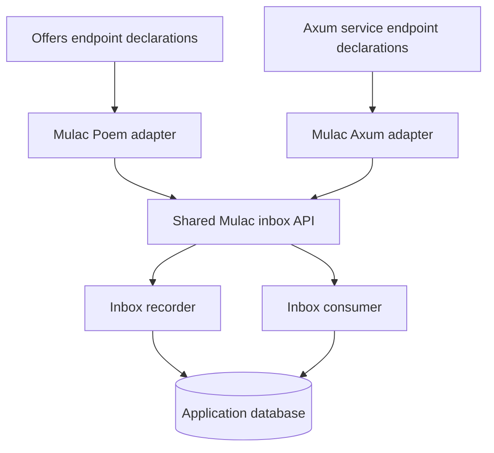

# Mulac inbox API adapters implementation plan

Status: Proposed implementation plan. No implementation changes are included.

## Objective and scope

Add a shared inbox API crate and two adapter crates in Mulac, then reduce offers'
inbox endpoints to declarations and delegation calls. Both adapters use the same
validation and execution logic.

This covers `POST /inbox` and `POST /inbox/run`, mounted under `/api` in offers.
Commands, events, and outbox processing retain their current behavior.

The implementation targets the Mulac checkout referenced by offers:
`/home/nulllabs/work/bodul/mulac`.

## 1. Establish the crate boundaries

Add these crates to Mulac's existing `libs` workspace:

| Location | Responsibility |
| --- | --- |
| `libs/inbox_api` | Shared request/response contract, validation, submission and batch operations, optional Tokio execution, PostgreSQL assembly helpers |
| `libs/mulac_poem` | Poem/OpenAPI types, request parsing integration, response and error conversion |
| `libs/mulac_axum` | Axum extractors, response and error conversion, optional Utoipa schema support |

Keep storage, deduplication, reservations, and retry behavior in the existing
`mulac-inbox` crate.



Each new crate exposes its public interface through `io`, following Mulac's
conventions. Framework adapters depend on the shared API; the shared API does
not depend on either framework or the kernel.

Services continue to own paths, authentication, middleware, database
configuration, migration execution, and server lifecycle.

## 2. Freeze the existing HTTP contract

Before extraction, extend characterization tests where the current behavior is
not already covered.

| Case | Required behavior |
| --- | --- |
| Valid submission | `202` with `{"message_id":"<uuid>"}` after storage succeeds |
| Missing message ID | Generate UUID v7 through the existing envelope conversion |
| Duplicate message ID | `202`; preserve every column of the original row |
| Payload | Required; accepts any JSON value, including explicit `null` |
| Routing key | Required string containing non-whitespace text; preserve its original value |
| Optional metadata | Preserve current UUID parsing and missing/null behavior |
| Unknown routing key | Accept at submission; processing resolves the command |
| Malformed JSON or invalid fields | `400` |
| Submission storage failure | `500` with the existing sanitized message |
| Blocking-task failure | `500` with the existing sanitized message |
| Run limit | Required integer from `1` through `1000` |
| Successful batch | `200`, `{"processed":N,"errors":[]}` |
| Consumer failure | `200`, `{"processed":null,"errors":[...]}` |
| Partial batch failure | Successful items remain committed |

Preserve existing batch error strings during this extraction. Submission
currently sanitizes storage errors, while batch responses expose consumer error
messages; changing that policy would be a separate behavior change.

Also characterize unknown fields, content-type handling, and parser edge cases
before replacing the current parsing. Framework-generated malformed-input
wording does not need to be identical across frameworks, but accepted inputs,
statuses, response shapes, and explicit Mulac error messages must agree.

## 3. Implement the shared inbox API

Introduce these public concepts in `inbox_api`:

| Proposed type | Purpose |
| --- | --- |
| `SubmitInboxRequest` | Shared Serde submission contract |
| `SubmitInboxResponse` | Accepted message ID |
| `RunRequest` | Shared batch request |
| `RunResponse` | Processed count and errors |
| `InboxApiError` | Typed validation and execution failures |
| `InboxService` | Synchronous submission and batch operations |
| `AsyncInboxService` | Optional Tokio wrapper around blocking operations |

Implement submission in this order:

1. Validate the request.
2. Convert it into the existing `NewInboxMessageEnvelope`.
3. Capture the assigned message ID.
4. Call `InboxRecorder::publish`.
5. Return the ID only after storage succeeds.

Implement batch execution by validating the limit, constructing
`ReservableInboxSpec`, calling the existing consumer, and converting its result
into `RunResponse`.

Implementation requirements:

- Explicitly distinguish a missing `payload` from `"payload": null`; do not rely
  on a plain `Value` field to enforce presence.
- Keep string parsing strict, including optional metadata.
- Keep validation independent of framework extraction so direct callers receive
  the same checks.
- Construct errors in named helpers.
- Preserve internal failure causes without including storage or panic
  diagnostics in submission responses.
- Leave transactions, retries, scheduling, and deduplication in the existing
  components.

## 4. Centralize runtime and construction code

Enable Tokio through an optional feature on `inbox_api`. Both HTTP
adapters enable it.

`AsyncInboxService` owns the repeated `spawn_blocking` pattern and maps task
failures into typed errors. It uses the application's existing runtime and does
not create a runtime, server, connection pool, or background worker.

Provide two construction paths:

```rust
// Explicit components: supports tests and custom storage.
InboxService::new(recorder, consumer)

// PostgreSQL convenience assembly using an existing pool.
InboxService::from_postgres(pool)
```

These signatures are proposed API names.

The PostgreSQL constructor moves the repeated assembly from offers into Mulac.
It must construct an inbox consumer with a queued command gateway, preserving
the rule that `/inbox/run` queues commands without executing them.

Gate PostgreSQL assembly behind `diesel`. Audit transitive feature activation:
the current inbox -> commanding -> eventing dependency chain enables some
defaults, so disabling Diesel at the new crate alone does not establish a
database-free dependency tree. Make any necessary feature-forwarding changes
explicit and test them.

Document that disconnecting an HTTP request does not necessarily stop an
already-running blocking database operation.

## 5. Implement the Poem adapter

`mulac_poem` provides:

- `InboxAdapter`.
- Poem-compatible submission and batch request/response types.
- The `202` submission response type.
- Framework error conversion.
- OpenAPI schemas and parsing integration.

Use adapter-owned types or wrappers for Poem traits. Keep contract parsing
delegated to the shared implementation; do not reproduce business validation in
Poem attributes.

Offers retains these thin methods. The types and methods are proposed APIs:

```rust
#[OpenApi]
impl InboxApi {
    #[oai(path = "/inbox", method = "post")]
    async fn submit(
        &self,
        request: Json<SubmitInboxRequest>,
    ) -> poem::Result<InboxSubmission> {
        self.adapter.submit(request).await
    }

    #[oai(path = "/inbox/run", method = "post")]
    async fn run(
        &self,
        request: Json<RunRequest>,
    ) -> poem::Result<Json<RunResponse>> {
        self.adapter.run(request).await
    }
}
```

Preserve the existing OpenAPI schema names, required fields, response status,
arbitrary JSON payload representation, and limit bounds.

The other queue endpoints currently use schemas named `RunRequest` and
`RunResponse`. Reuse the adapter's equivalent types there, avoiding conflicting
schema registrations while leaving their processing logic unchanged.

## 6. Implement the Axum adapter

`mulac_axum` provides:

- A cloneable `InboxAdapter` backed by `AsyncInboxService`.
- Submission and batch extractors that delegate to shared parsing.
- Typed response and error conversions implementing `IntoResponse`.
- Optional `utoipa` support for adapter-owned schemas.

Axum's default JSON extractor returns `422` for some deserialization failures.
The adapter must normalize invalid inbox JSON fields to `400`, matching the
existing contract. It must preserve body-limit and unsupported-media-type
handling rather than indiscriminately converting every rejection to `400`.
See the [Axum rejection definitions](https://docs.rs/axum/latest/src/axum/extract/rejection.rs.html).

The intended application integration is:

```rust
async fn submit_inbox(
    State(inbox): State<InboxAdapter>,
    request: SubmitInbox,
) -> Result<InboxSubmission, InboxHttpError> {
    inbox.submit(request).await
}

async fn run_inbox(
    State(inbox): State<InboxAdapter>,
    request: RunInbox,
) -> Result<InboxRunResponse, InboxHttpError> {
    inbox.run(request).await
}

let inbox_routes = Router::new()
    .route("/inbox", post(submit_inbox))
    .route("/inbox/run", post(run_inbox))
    .with_state(inbox_adapter);

let app = Router::new().nest("/api", inbox_routes);
```

These are proposed adapter types. The adapter owns extractor rejection
handling, so applications do not repeat it. Axum supports custom extractors for
this purpose; see the [Axum extractor documentation](https://docs.rs/axum/latest/axum/extract/index.html).

For OpenAPI, provide optional Utoipa schemas and a compiling example of
application-owned path annotations. Match the Utoipa version already used by
retailer sourcing. Do not require Utoipa for applications that only need HTTP
endpoints.

## 7. Integrate offers

Make the following focused changes:

| File | Change |
| --- | --- |
| `Cargo.toml` | Add the shared API and Poem adapter dependencies |
| `src/orchestration/mod.rs` | Replace local inbox assembly with Mulac constructors |
| `src/orchestration/api.rs` | Remove inbox validation, conversion, execution, and error-building code |
| New `src/orchestration/inbox_api.rs` | Keep only the two endpoint declarations and delegation |
| `src/main.rs` | Construct the shared service/adapter and register `InboxApi` in the existing API tuple |
| `src/postgres_tests.rs` | Adapt setup while retaining end-to-end persistence assertions |
| `README.md` | Document the new ownership and integration |

Use one shared inbox service instance for submission and processing. Retain
explicit dependency injection for tests, including the existing panicking-store
test.

Register `InboxApi` alongside `OffersApi`, the remaining `QueueApi`, and
`ReportingApi`. Keep the existing `/api` mount, OpenAPI endpoint, Swagger UI,
and GraphQL integration.

## 8. Build a shared verification suite

Use one set of request/response fixtures for both adapters, with a small
framework-specific test harness.

| Test layer | Coverage |
| --- | --- |
| Shared contract | Missing/null distinctions, strict strings, UUIDs, whitespace preservation, arbitrary payloads, batch limits |
| Shared operations | Assigned IDs, storage failures, empty batches, consumer failures |
| Tokio wrapper | Blocking operations and sanitized task failures |
| Poem HTTP | Statuses, responses, malformed requests, route mounting, OpenAPI |
| Axum HTTP | The same contract, normalized JSON rejections, state/router composition |
| PostgreSQL | Deduplication, unchanged duplicate rows, metadata, reservations, retry scheduling, partial failures |
| Offers integration | Submission -> inbox -> commands -> events -> offer projections |

For database-independent tests, use Mulac's existing storage and reservation
ports rather than introducing a second abstraction solely for mocking.

Provide compiling Poem and Axum integration examples. Include an Axum OpenAPI
example with `utoipa` enabled, and test the plain Axum configuration without it.

## 9. Update documentation, CI, and packaging

Record the architecture in a new Mulac ADR and update its ADR index. Document
crate responsibilities, feature flags, construction, both framework
integrations, and the HTTP contract.

Create new crates with `cargo new`, add them to `libs/Cargo.toml`, and give each
a README. Declare shared dependencies at workspace level. Update Mulac's
explicit packaging/publishing lists so releases include the new crates in
dependency order.

Verification during implementation:

- Run formatting first.
- Add a Mulac `make ci` target covering format checks, linting, and tests; its
  current Makefile has no `ci` target.
- Test shared API feature combinations and each adapter independently.
- Verify neither adapter pulls in the other framework.
- Run offers' `make ci` and `make test-postgres`.
- Run offers with `PORT=<port> make serve`; verify `/api/health`, OpenAPI, and an
  inbox request.
- Run dependency auditing because manifests and lockfiles will change; report
  new advisories.
- Check that examples and package manifests work beyond local path-only
  development.

## 10. Deliver in reviewable stages

1. Contract characterization and architecture decision.
2. Shared API, runtime wrapper, and construction helpers.
3. Poem adapter with contract and schema tests.
4. Axum adapter with contract tests and optional OpenAPI support.
5. Offers migration and end-to-end verification.
6. Final documentation and packaging verification.

## Completion criteria

- Both frameworks pass the shared inbox contract.
- Offers contains only endpoint declarations and delegation for inbox
  operations.
- Existing persistence and staged-processing guarantees remain intact.
- Both integrations have compiling examples and documented OpenAPI support.
- Required formatting, CI, PostgreSQL, startup, and dependency checks pass,
  with any new dependency advisories reported.
