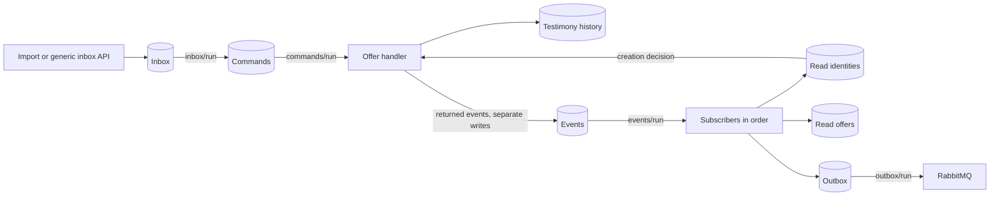

**Offers service review — 2026-10-23**

The service has a useful ingestion skeleton, but its current persistence and
delivery boundaries are not safe for reliable offer processing. Ordinary batch
imports can create duplicate aggregate histories. Recoverable failures can lose
events, leave partial updates committed, strand commands, or make projections
regress. These are demonstrated behavior, not just concerns inferred from the
design. Stabilize those boundaries before expanding the integration or relying
on the service for durable business state.

This review combines architecture, principal-engineering, and staff-engineering
perspectives across domain logic, persistence, projections, messaging, HTTP,
operations, dependencies, documentation, and tests. It covers the current tree,
not only a recent diff.

| Review baseline             | Value                                                                                             |
| --------------------------- | ------------------------------------------------------------------------------------------------- |
| Branch                      | `wip/offer-service-setup`                                                                         |
| Monorepo commit             | `28514e97fe1b9526419dd8252a56fc0e2944e040`                                                        |
| Locally linked Mulac commit | `c51c3cf9cec67a84bd456d55f8aad342fe7fbac0`                                                        |
| Initial working trees       | Monorepo and Mulac clean                                                                          |
| Review changes              | This Markdown report only; no implementation changes                                              |
| Severity                    | P1: fix before relying on the service/build; P2: correctness or maintenance work to schedule next |

Source links below are relative to this document; cited line numbers refer to
the reviewed baseline. Links into Mulac refer to the sibling checkout actually
used by this service.

The actual pipeline accepts imports into the inbox, advances each stage through
an explicit HTTP request, saves Testimony history, dispatches events to two read
models and an outbox subscriber, and optionally publishes the outbox to RabbitMQ.
Updates are already active when the identity projection contains the offer.
There are no offer-read HTTP routes or background queue workers. PostgreSQL is
required at startup; GraphQL currently provides health only.

The feature modules and thin Mulac HTTP adapters are useful foundations. The
generic inbox preserves caller-supplied message IDs and deduplicates submissions.
Stored event variants have explicit version tags. RabbitMQ publication uses
persistent messages, mandatory routing, and publisher confirms. Reporting
authorizes requests before database access and sanitizes errors. PostgreSQL
tests create isolated schemas. These choices should be retained while the
transaction and replay guarantees are repaired.

The findings below are ordered by impact. Findings 1–6 and 8 were reproduced
against a running service in an isolated PostgreSQL test schema. Findings 7 and
9 are based on source/configuration inspection.

1. **P1 — Identity allocation depends on a delayed read projection.**

   **Status: Deferred for now.** Tracked in
   [bodul-hq/monorepo#18](https://github.com/bodul-hq/monorepo/issues/18).

   [The handler](../src/offers/handler.rs), lines 39–73, queries
   `read_offer_identities` and generates a new UUID when no row exists.
   [The lookup implementation](../src/infra/identifiers_repository.rs), line 65,
   reads that projection; only later event processing inserts it. There is no
   authoritative identity allocation in the command transaction.

   Submit two imports for the same retailer and URL, then run inbox and commands
   before events. Both commands successfully create different aggregate
   histories. In the live reproduction, `event_store` contained **two aggregate
   IDs**, while `read_offers` contained **one row**. Event processing failed on
   `read_offers_retailer_code_url_key`. Concurrency is not required.

   Allocate a stable ID in a write-side identity table with a unique
   retailer/URL constraint, and serialize each identity's import transaction.
   Do not consult an eventual projection to decide whether an aggregate exists.
   Add tests for repeated imports before projection and concurrent imports of
   the same identity. This is already the design required by
   [ADR 15](../../../docs/adr/0015-offers-testimony-and-mulac.md).

2. **P1 — An update can commit to history and permanently lose its events.**

   [The handler](../src/offers/handler.rs), lines 108–115, saves the aggregate
   before returning its events. [Mulac's command dispatcher](../../../../mulac/libs/commanding/src/dispatcher.rs),
   lines 108–112, records those returned events afterward. The command has no
   durable receipt that preserves its original result for retries.

   Reproduction: create and project an offer titled `Original`, submit an update
   to `Updated`, and temporarily reject inserts into `event_entries`. The
   command fails after history commits. Repair the insert failure and retry the
   same command: it returns success because replay already contains `Updated`
   and the aggregate emits no changes. Observed state: history title
   **`Updated`**, projection title **`Original`**, **two completed commands**, and
   **only the original creation event** in the event queue. Subsequent event
   processing reports zero work.

   Persist identity, complete history changes, and a command receipt containing
   publishable events in one transaction. Retrying the same command must return
   the recorded result, with stable event identity, even after later commands.
   Carry the original command UUID through the handler boundary and key the
   receipt by it; the current typed command contains no ID. Reject reuse of
   that UUID with different input.
   An atomic history/outbox design is another option, but it must close this
   exact failure window. Inbox submission deduplication alone does not do so.

3. **P1 — A transient subscriber failure makes creation retries fail permanently.**

   Both [offer insertion](../src/read_offer/repository/postgres.rs), line 24,
   and [identity insertion](../src/read_offers_identifiers/repository/postgres.rs),
   line 29, use plain `INSERT`. Subscribers run in offer → identity → outbox
   order, as registered in [startup](../src/main.rs), lines 91–106.
   [Mulac stops at the first subscriber error](../../../../mulac/kernel/src/event_subscriber_registry.rs),
   line 38, and retries the event from the first subscriber.

   Temporarily rejecting an outbox insert let both creation projections commit
   before event processing failed. After removing the fault, retry failed on
   `read_offers_pkey` before reaching the outbox subscriber. The outbox remained
   empty. Repeated retries cannot repair this state and eventually exhaust the
   attempt limit. The same issue applies to failure between the two projections
   and to replay of a completed creation event.

   Make each subscriber idempotent for the same event, or persist subscriber
   checkpoints atomically with their effects. Preserve errors for genuinely
   conflicting identities; a blanket conflict-ignore must not hide finding 1.
   Replaying creation must also preserve any newer projected title or price;
   an unconditional upsert would introduce a different regression.
   Extend the current subscriber-failure test through fault repair and successful
   retry. The README acknowledges duplicate projection failures, but their
   consequence includes permanently missing customer-facing delivery.

4. **P1 — Retrying an older update overwrites newer projected state.**

   [Published update events](../src/offers/event.rs), lines 38–46, carry no
   aggregate sequence. [Event extraction](../src/offers/aggregate.rs), lines
   22–26, discards the Testimony envelope sequence. [Projection updates](../src/read_offer/repository/postgres.rs),
   lines 43 and 59, unconditionally replace title or price.

   Reproduction: process title `Title A` while outbox insertion fails, then
   repair the outbox and successfully process a newer `Title B` update before
   A's retry is due. Retrying A changes the projection from **`Title B` back to
   `Title A`**. Customer-facing events can also arrive in this order without
   giving consumers enough information to reject stale state.

   Preserve aggregate sequence in the integration contract and enforce it when
   projecting. Full snapshots plus a conditional newer-sequence upsert match
   ADR 15. If retaining field-level delta events, use ordered processing or
   suitable per-field checkpoints: skipping every lower aggregate sequence can
   lose a legitimate update to a different field.

5. **P1 — One title-and-price update can commit only half its history.**

   [Offers repository construction](../src/infra/repository.rs), lines 21–24,
   selects the pool-based event store. [Its append implementation](../../../lib/testimony_infra/src/postgres_event_store.rs),
   lines 138–147, delegates without opening a transaction. The connection
   adapter then inserts events individually in the loop at lines 243–288.

   Reproduction: submit an update changing both title and price, and reject the
   `OfferPriceChanged.v1` history insert. The title event commits, the price event
   does not, and no corresponding update events reach Mulac. Observed history
   contains the creation plus **one title-change event** after the request
   fails. Recovering the command cannot reconstruct its original publishable
   result without a receipt.

   Use `ConnectionEventStore` inside the caller-owned import transaction, so all
   history events and the receipt commit or roll back together. Add a test that
   fails the second append and checks that neither update event persists. This
   is a separate failure point from finding 2: it occurs during history append,
   before event-queue insertion starts.

6. **P1 — Recoverable update errors panic and leave commands reserved.**

   [The update handler](../src/offers/handler.rs), lines 98–113, unwraps load,
   missing-aggregate, and save results, and ignores `aggregate.update` errors.
   [Mulac reserves a batch before processing](../../../../mulac/libs/commanding/src/command_consumer.rs),
   lines 222–233, and marks an item failed only when dispatch returns `Err`
   at lines 252–263.

   The failed second history insert in finding 5 produced HTTP **500** with
   `queue processing task failed`. The command remained **status 2, reserved**,
   rather than entering the retry schedule. A database load failure or
   concurrent sequence conflict follows the same unwrap path. Code inspection
   also shows that unprocessed entries in the reserved batch remain stranded
   when the loop unwinds; the live reproduction used a single update command.

   Propagate named domain/repository errors, including a missing aggregate and
   failed update, through `CommandError`. Test failures at load and append and
   verify reservation release/backoff. Add an explicit crash-recovery mechanism
   as well: replacing unwraps cannot recover reservations abandoned by process
   termination.

7. **P1 — The checked-in dependency configuration cannot reproduce the build independently.**

   [Cargo.toml](../Cargo.toml), lines 11–24, uses seven `../../../mulac/...`
   path dependencies outside the monorepo, replacing pinned dependency entries.
   A monorepo checkout alone cannot resolve these paths. Even when the sibling
   repository exists, the monorepo commit and lockfile do not pin its contents.
   The successful checks in this review used the local Mulac commit recorded
   above; they do not demonstrate a standalone clean-checkout build.

   Pin the required Mulac revision/packages in workspace dependencies, or make
   the sibling checkout an explicitly pinned, provisioned build input. Keep
   local overrides separate from the reproducible default. Verify a build in
   an environment containing only declared inputs. The README currently
   describes a pinned Git dependency instead.

8. **P2 — Import validation allows invalid business state to be persisted.**

   [REST conversion](../src/offers/http/rest.rs), lines 35–43, validates only
   retailer and currency. [The command](../src/offers/command.rs), lines 10–16,
   deserializes unrestricted strings and price, and the handler/aggregate do
   not restore the missing checks.

   A request with title **three spaces**, price **-1**, and URL
   **`relative-url`** returned **202**. All three processing stages succeeded
   and those exact values reached `read_offers`. Code inspection also shows
   that oversized URLs are rejected by projection validation after history has
   already accepted them.

   Define shared domain guards for nonblank title, nonnegative price, and the
   agreed absolute HTTP(S) URL/length/control-character rules. Validate before
   direct inbox submission and again at command execution, because generic
   inbox messages bypass the direct REST conversion. Use the repository's named
   error helpers. Test both ingress paths and ensure rejected commands do not
   append history.

9. **P2 — Documentation and the accepted architecture promise incompatible behavior.**

   [The current-server description](../README.md), lines 201–202, says every
   import gets a new UUID and updates are not wired, although the handler now
   updates an existing identity. The legacy-plan disclaimer at line 215 is
   followed by a mixture of current setup guidance, inactive routes, and
   obsolete consistency guarantees. The test coverage claim at lines 456–459
   includes receipts, concurrent imports, rollback, and projection ordering
   that the current service suite does not establish.

   [Accepted ADR 15](../../../docs/adr/0015-offers-testimony-and-mulac.md)
   explicitly requires authoritative identity allocation, transactional receipts,
   and sequence-aware projections. These guarantees are absent from the active
   path. This makes it difficult to tell intentional scope reductions from
   unfinished implementation and can cause callers to assume reliability the
   service does not have.

   Make the operational README describe only the current implementation and
   actual checks; move the earlier plan into a separate clearly marked document.
   Restore the accepted guarantees, or write a superseding ADR if a different
   architecture is intentional. Do not silently edit an accepted decision to
   match the code.

Verification performed for this review:

| Check                                              | Result and scope                                                                                    |
| -------------------------------------------------- | --------------------------------------------------------------------------------------------------- |
| `make ci`                                          | Passed formatting, Clippy, and 49 tests; 13 integration tests ignored by default                    |
| `make test-postgres`                               | All 12 PostgreSQL tests passed using the configured test database and isolated schemas              |
| `PORT=3107 make serve`                             | Started successfully with `DATABASE_URL` scoped to a new isolated test schema                       |
| `GET /api/health`                                  | HTTP 200, body `ok`                                                                                 |
| Same-identity imports before projection            | Reproduced two histories and one projection, followed by unique-constraint failure                  |
| Event-queue insertion failure after update history | Reproduced successful retry with permanently missing update event                                   |
| Outbox failure during creation, followed by repair | Reproduced retry blocked by duplicate projection, empty outbox                                      |
| Older update retried after newer update            | Reproduced title regression from B to A                                                             |
| Failure on second history insert                   | Reproduced partial history, HTTP 500, reserved command                                              |
| Invalid direct import                              | Reproduced blank title, negative price, relative URL in read model                                  |
| RabbitMQ integration test                          | Not run; live broker confirmation behavior was inspected, not independently verified in this review |
| Dependency audit                                   | Not run; no Cargo dependency or lockfile changes                                                    |

Fault injection used temporary `CHECK` constraints in the review schema to
reject inserts into `event_entries`, `outbox_entries`, or only
`OfferPriceChanged.v1` in `event_store`. Removing the constraint repaired the
storage fault. Failed rows were made due by adjusting `scheduled_at` inside
that schema; no existing application rows were changed. The temporary server
was stopped and the schema was dropped afterward. The reproduction harness
was temporary tooling, not an addition to the project's Rust test suite.

Passing checks therefore establish the covered happy paths and adapter
contracts, not the missing consistency guarantees. In particular,
[the projection-update integration test](../src/postgres_tests.rs), starting
at line 438, injects update events directly instead of exercising repeat
imports through the handler. The subscriber-failure test starting at line 1166
checks failure and backoff without repairing the fault and retrying to
completion. The demonstrated cases above should become permanent PostgreSQL
regression tests and run in the required integration checks.

Several additional release prerequisites are already documented development
choices, so they are distinguished from the unexpected correctness failures:

| Area                | Current state                                                                                                                | Required decision or work before broader operation                                                                                         |
| ------------------- | ---------------------------------------------------------------------------------------------------------------------------- | ------------------------------------------------------------------------------------------------------------------------------------------ |
| Access control      | Import, generic inbox, and queue runners are unauthenticated; server binds `0.0.0.0`. Reporting alone checks a bearer token. | Define and enforce a trusted-network contract or service/operator authentication. Review external reachability before exposure.            |
| Recovery            | No stale-reservation sweeper or supported recovery interface.                                                                | Provide age/ownership-aware recovery, a dead-item procedure, and crash-recovery tests.                                                     |
| Processing          | All four queue stages require explicit calls.                                                                                | Assign responsibility for advancing stages, retries, scheduling, and alerts; manual processing can remain a deliberate development choice. |
| Observability       | Queue-status reporting covers commands/events, not inbox/outbox; health is liveness only.                                    | Add all-stage backlog/age/attempt/dead/reserved visibility, readiness, and structured diagnostics with correlation IDs.                    |
| Read capability     | Projections exist, but offers cannot be retrieved through active HTTP routes.                                                | Agree the first supported read contract and implement its smoke/consistency tests after write correctness is established.                  |
| Event compatibility | Stored record tags are versioned; outgoing event type names are not explicitly versioned and omit sequence.                  | Define compatibility and consumer deduplication/order rules before customer-facing integration depends on them.                            |

A practical remediation sequence is:

1. Capture the reproduced failures as regression tests and restore reproducible
   dependency resolution. Keep the review baseline available for comparison.
2. Implement one authoritative import transaction: allocate/lock identity,
   replay validated history, apply changes, append all events, and store the
   command result for retry. Propagate failures through normal error paths.
3. Make event projection and delivery safe under duplicate, partial, and
   out-of-order execution. Carry stable event identity and sequence through the
   wire contract, and test repaired retries to completion.
4. Restore domain guards and reconcile README/ADR guarantees with the chosen
   implementation. Require PostgreSQL regression checks alongside unit checks.
5. Complete access control, recovery, monitoring, processing ownership, and the
   first read API before expanding live upstream/downstream integration.

The next milestone should demonstrate that repeated imports, interrupted
processing, and replay converge on one correct offer history and projection,
with recoverable downstream delivery. Adding more endpoints before that would
increase the number of callers exposed to the existing failures.
