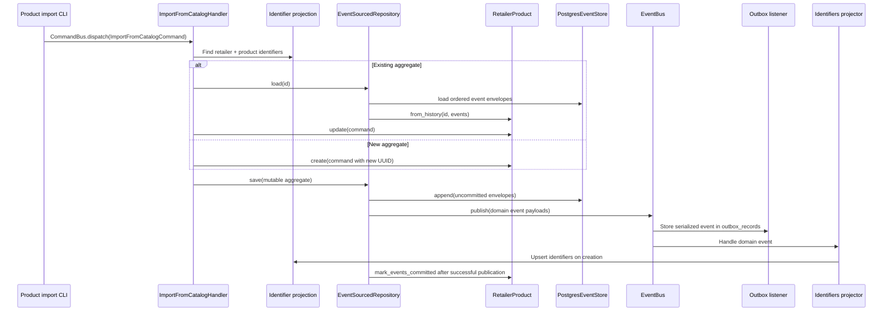

# Testimony: flow, wiring, and running bodulv6

Source reference: `/home/nulllabs/work/labs/bodulv6`, commit `da93e7f`,
inspected on 2026-10-18. Paths beginning with `lib/`, `retailer/`, or
`retailer_product/` below are relative to that repository unless stated
otherwise. This document describes the implementation; some of its older
specifications disagree with the code. The run commands are derived from source
inspection and have not been exercised against a live bodulv6 database.

For the implemented offers service, its setup and current retry guarantees,
see [README.md](README.md). The bodulv6 behavior below is a reference snapshot.

## What provides what

| Piece                  | Responsibility                                                                                                        |
| ---------------------- | --------------------------------------------------------------------------------------------------------------------- |
| `lib/testimony`        | Aggregate, event envelope, store/publisher contracts, aggregate repository, query dispatch.                           |
| `lib/testimony_infra`  | In-memory and PostgreSQL event stores; Diesel pool alias, event row and metadata records, base event-store migration. |
| `lib/orchestration`    | Command bus and handlers, event bus and listeners, inbox/outbox ledgers and batch processors.                         |
| `lib/orchestration_pg` | PostgreSQL implementations of inbox/outbox repositories and row mappings.                                             |
| `lib/everyday`         | Domain value types, including the timestamp carried by event envelopes.                                               |
| `lib/elemental`        | Retailer identifiers/codes used by bodulv6 domain and application code.                                               |
| `<domain>/core`        | Aggregate state, commands, domain events, identifiers, replay logic.                                                  |
| `<domain>/app`         | Use cases, command conversion/dispatch, read-model interfaces and projectors.                                         |
| `<domain>/infra`       | Serializable event records, conversion to/from domain events, read-model database adapters, migrations.               |
| `<domain>/bootstrap`   | Connection pool and dependency container that assembles all of the above.                                             |
| `<domain>/cli`         | Actual import and inbox-consumption entry points.                                                                     |
| `<domain>/web`         | Placeholder HTTP server in `retailer` and `retailer_product`; no command API is wired.                                |

There are separate Cargo workspaces in `lib`, `retailer`, `retailer_product`,
and `retailer_sourcing`. Select the workspace, package, and binary explicitly
when running a command.

`testimony` and `testimony_infra` are libraries loaded into the application
process. There is no Testimony server to start and no broker required for the
local command/event bus. Each domain container gives its event store, read
repositories, inbox, and outbox the same domain database pool.

## The product import flow

`retailer_product/cli/src/bin/import.rs` reads catalog JSON files and dispatches
commands directly. It does not first enqueue inbox messages.



The lookup uses retailer code plus product ID, optionally SKU or variant ID. For
an existing ID, the handler replays its stream and calls `update`. For a new
product, it generates a UUID and calls `create`. Both paths call `save`.
Importing unchanged data again still produces an update event; the handler does
not compare values to suppress unchanged imports.

The identifiers projector writes `retailer_product_identifiers` on
`CreatedFromCatalog`. Its update handler currently does nothing, as do its
page-event handlers. This projection is needed for subsequent import lookups.
Losing it can make an existing retailer product appear new; the natural-key
lookup indexes are not unique constraints.

The richer `retailer` domain uses the same repository pattern. Its event bus
registers the outbox listener followed by identifiers, info, channels, and
locations projectors. Its import CLI stores inbox messages, and the separate
`inbox-consumer` binary dispatches them to the command handlers.

## Aggregate and repository contracts

| Contract            | Implementation requirement                                                                                                          |
| ------------------- | ----------------------------------------------------------------------------------------------------------------------------------- |
| `Aggregate`         | Define `Event: Clone` and `Id: Clone`; implement `from_history`, `uncommitted_events`, and `mark_events_committed`.                 |
| `HasAggregateId`    | Return the stream ID from each event variant. Implement it on the event record enum too.                                            |
| `EventEnvelope<E>`  | Carry event, `u64` sequence, and `everyday::DateTime`. `new` timestamps a new event; `with_timestamp` preserves a stored timestamp. |
| `EventStore<Id, E>` | Implement synchronous `load(id)` and `append(Vec<EventEnvelope<E>>)`.                                                               |
| `EventPublisher<E>` | Implement synchronous publication of `&[E]`. The repository publishes payloads without their envelope sequence/timestamp.           |

The reference aggregates start their streams at sequence 1, advance the sequence
when recording a new event, and keep those envelopes in an uncommitted list.
Replaying a history must restore state and the current sequence while leaving
that list empty. Replay must not publish events or write projections.

`EventSourcedRepository<A, S, P>` handles the following:

1. `load(id)` asks the store for envelopes, returns `Ok(None)` for an empty
   stream, sorts by sequence, and calls `A::from_history`.
2. `save(&mut aggregate)` copies the uncommitted envelopes. An empty list is
   a successful no-op.
3. It appends those envelopes to the store, publishes their payloads, then
   clears the aggregate's uncommitted list.
4. A store error returns `RepositoryError::EventStore`. A publication error
   returns `RepositoryError::Publisher` after the append already succeeded.

`Aggregate::from_history` returns `Self`, not a `Result`. The product
aggregate's fallible `try_from_history` is wrapped with `expect` in its trait
implementation, so an invalid history can panic rather than produce a repository
error.

The actual save order is **append → publish → clear**. The older
`docs/technical/specifications/testimony.md` describes clearing before
publication; use `lib/testimony/src/event_sourced_repository.rs` as the source
of truth.

## Storage and serialization

The PostgreSQL adapter has three type parameters:

```rust
type ProductStore = PostgresEventStore<
    RetailerProductId,
    RetailerProductEvent,
    RetailerProductEventRecord,
>;
```

`Id` must implement `ToString + Clone`, the domain event `E` must implement
`Clone + HasAggregateId`, and the record `R` must implement `Serialize +
DeserializeOwned + HasAggregateId`. The adapter also requires fallible
conversions `R: TryFrom<&E>` and `E: TryFrom<R>`, with displayable conversion
errors.

There are two different record layers:

- `RetailerProductEventRecord` is the serializable domain payload enum. It
  converts value objects into strings, numbers, and JSON-compatible data.
- `testimony_infra::EventStoreRecord` is the database row around that payload,
  including its stream ID, sequence, and timestamp.

The concrete product conversions are in
`retailer_product/infra/src/models/retailer_product_event/mod.rs`. They use
Serde's default externally tagged enum format, for example
`{"CreatedFromCatalog": {...}}`. A Rust or enum rename can therefore affect
stored JSON compatibility unless the serialized names are retained.

| `event_store` column        | Value                                                    |
| --------------------------- | -------------------------------------------------------- |
| `id BIGSERIAL`              | Database row ID.                                         |
| `agg_id VARCHAR(255)`       | `envelope.aggregate_id()`.                               |
| `sequence BIGINT`           | Envelope sequence; unique together with `agg_id`.        |
| `payload_type VARCHAR(255)` | `std::any::type_name::<R>()`, not the enum variant name. |
| `payload JSONB`             | Serialized `R`.                                          |
| `metadata JSONB`            | Adapter-generated `sequence` and `recorded_at` fields.   |
| `recorded_on TIMESTAMPTZ`   | Timestamp from the envelope, stored at second precision. |

Loading selects by `agg_id` and orders by sequence, deserializes JSON to `R`,
converts `R` to `E`, then rebuilds envelopes. `payload_type` is used in error
messages, not as a dynamic deserializer selector or a query filter. Keep streams
distinguishable by ID/table; sharing a table between unrelated event types
requires care.

`PostgresEventStore::new(pool)` uses `event_store`. `with_table_name(pool,
name)` allows a different table, with the same columns. The application supplies
the pool and applies migrations; constructing a store does neither. `Metadata`
and `MetadataRecord` exist as separate types, but arbitrary correlation metadata
is not carried through this envelope and append path automatically.

`InMemoryEventStore<Id, E>` needs no record conversions or database. Clones
share an `Rc<RefCell<...>>`; appends keep duplicates and sort streams by
sequence. Its behavior does not enforce PostgreSQL's uniqueness constraint, and
it is not safe to share across threads.

## Bootstrap wiring

Both `retailer/bootstrap/src/container.rs` and
`retailer_product/bootstrap/src/container.rs` construct dependencies lazily:

1. Establish a Diesel/r2d2 PostgreSQL pool with a maximum of 10 connections.
2. Construct domain read repositories and inbox/outbox repositories using
   clones of that pool.
3. Build an `EventBus`; subscribe the outbox listener first, then projectors.
4. Construct the typed `PostgresEventStore`.
5. Construct `EventSourcedRepository::with_publisher(store, Rc<EventBus>)`.
6. Give that repository and the identifier lookup repository to each command
   handler, then register handlers on the `CommandBus`.
7. For queued input, build `InboxPublisher` with its ledger and the domain's
   JSON-to-command dispatcher.

Minimal persistence can use `EventSourcedRepository::new(store)` with its
default `NoOpEventPublisher`. The reference import handler also relies on the
identifier projection, so removing its publisher requires an alternative way to
maintain that lookup.

Use `testimony::prelude::EventPublisher` when integrating with the aggregate
repository. `orchestration` also exports a distinct trait named
`EventPublisher`; its `EventBus` explicitly implements the Testimony trait.

The buses/container use `Rc` and `RefCell`, and Diesel access is synchronous.
Connecting this design to an async HTTP service requires explicit ownership and
execution boundaries for blocking work. The reference container cannot simply
become shared `Send + Sync` state for a multithreaded server.

`QueryBus` and `QueryHandler` in Testimony provide optional typed query
dispatch. The inspected bootstrap containers do not register a query bus; import
handlers call read repositories directly. Query dispatch does not automatically
create or rebuild projections.

## Inbox, outbox, and failure behavior

The inbox dispatcher takes a JSON wrapper containing `message_type` and `data`.
For products, `retailer.catalog.import` selects `ImportFromCatalogCommand`. It
also recognizes `retailer.page.import`, but the page handler is an empty
skeleton and is not registered in the container.

Both ledger batch processors reserve eligible rows through PostgreSQL `FOR
UPDATE SKIP LOCKED`, set status to reserved, and increment attempts. The inbox
processor dispatches a command and marks success as processed. The outbox
processor calls an application-supplied `MessagePublisher` and marks success as
published. Failures record errors and schedule another attempt using
`5^min(attempts, 9)` seconds of delay.

| Status   | Meaning                                             |
| -------- | --------------------------------------------------- |
| `0`      | New, eligible once `scheduled_at` is reached.       |
| `2`      | Reserved.                                           |
| `4`      | Failed, eligible again at `scheduled_at`.           |
| `5`      | Processed inbox message / published outbox message. |
| `7`, `8` | Dead / archived status definitions.                 |

`retailer/cli` provides a one-batch `inbox-consumer` executable; it is not a
daemon. The product container exposes `inbox_publisher()`, but its CLI has no
consumer binary. The repository contains the generic `OutboxPublisher`, but no
concrete delivery transport and executable wired to run it. Product imports
therefore populate the outbox without delivering it externally.

These implementation details matter for recovery:

- PostgreSQL append checks aggregate IDs and strictly increasing sequence
  numbers within the supplied batch. It does not check the next expected
  stored sequence or enforce contiguous numbering. The database uniqueness
  constraint rejects duplicate `(agg_id, sequence)` values.
- Appending several events runs separate inserts without an encompassing
  transaction. A later insert failure can leave earlier events persisted.
- Event append, outbox insertion, and projection writes use separate
  operations/connections. They are not one atomic transaction, despite the
  outbox listener's comment describing a transactional outbox.
- The event bus invokes listeners in registration order and continues after
  errors, collecting them. Registering the outbox first does not prevent a
  projector from running if outbox insertion fails.
- After a publisher failure, the aggregate still holds events that have
  already been stored. Calling `save` again can hit the unique constraint
  before publication is retried. There is no built-in repair/republication
  workflow or projection rebuild command.
- Reservation has no implemented timeout/reclaim loop. A crashed worker can
  leave rows at status `2`. The backoff cap is not a maximum retry count; the
  shown processors do not transition exhausted messages to dead status.
- The event-record mapper writes catalog availability as `0` and restores
  base-content brand as `None`. It is not a lossless round trip as written.
  Page aggregate replay also contains `todo!()`.

For persisted offers, define atomic append/outbox behavior, conflict handling,
idempotent consumers, and recovery of partial effects before relying on these
paths for durable delivery.

## Running the reference workflows

### Prerequisites and databases

Use a Rust toolchain supporting the manifests' 2024 edition, a C toolchain and
libpq development files for Diesel, Docker Compose for the supplied PostgreSQL
17 containers, and `psql` plus Diesel CLI with PostgreSQL support for manual
inspection/migrations. The data import additionally needs the external JSON
input files; the importer does not crawl or scrape them.

The compose files bind host directories under `/var/*_postgres_data` and use
fixed Docker network addresses. They expose PostgreSQL on their networks without
publishing a localhost port. The URLs below assume the Linux host can reach
those bridge addresses. Configure libpq authentication using the credentials
from the matching compose file, for example through a `.pgpass` file with mode
`0600` and `PGPASSFILE` pointing to it.

| Database           | Compose file                             | Development / test host             | Runtime variable                                     |
| ------------------ | ---------------------------------------- | ----------------------------------- | ---------------------------------------------------- |
| `retailer_product` | `retailer_product/docker-compose.yml`    | `172.28.102.102` / `172.28.102.201` | `RETAILER_PRODUCT_DATABASE_URL`                      |
| `retailer`         | `retailer/docker-compose.yml`            | `172.28.101.102` / `172.28.101.201` | `DATABASE_URL`                                       |
| `testimony`        | `lib/testimony_infra/docker-compose.yml` | `172.28.34.102` / `172.28.34.201`   | No library-owned connection variable; supply a pool. |

The standalone `testimony` database is optional. Each domain's own migration
directory already creates its `event_store`, inbox, outbox, and read tables.
Apply only that domain's migrations to its database; do not also apply the
library migration to the same database.

### Product catalog import

Run these commands from the reference repository root after configuring database
authentication:

```sh
cd /home/nulllabs/work/labs/bodulv6
docker compose -f retailer_product/docker-compose.yml -p retailer_product \
  up -d retailer_product_postgres_dev
docker compose -f retailer_product/docker-compose.yml -p retailer_product \
  exec -T retailer_product_postgres_dev pg_isready -U root -d retailer_product

export RETAILER_PRODUCT_DATABASE_URL='postgres://root@172.28.102.102:5432/retailer_product'
(
  cd retailer_product/infra
  diesel migration run --database-url "$RETAILER_PRODUCT_DATABASE_URL"
)

export RETAILER_PRODUCT_DATA_PATH='/path/to/catalog-data/{retailer_version}/final_values'
cargo run --manifest-path retailer_product/Cargo.toml \
  -p retailer_product_cli --bin import -- --retailer-and-version admhr_v1
```

Wait until `pg_isready` succeeds before migrating. The startup functions load
`.env` using `dotenvy`, but `retailer_product/.env.example` only contains the
data path; the database URL must also be supplied. Exported shell variables work
regardless of which directory is used to launch Cargo.

The importer replaces `{retailer_version}` in the path and reads each regular
file in that directory as one `AdmhrV1CatalogPageItem`. The flag changes the
directory; the executable always deserializes the ADM format, even if another
retailer/version string is passed. A minimal fixture matching its fields is:

```json
{
  "id": 1,
  "sku": "demo-1",
  "title": "Example item",
  "url": "https://example.com/items/1",
  "brand": "Example",
  "image": "https://example.com/items/1.jpg",
  "category_id": 1,
  "list_id": "demo",
  "categories": [],
  "lists": [],
  "price": { "amount": 1000, "currency": "EUR" },
  "old_price": null,
  "additional_discount_percentage_for_one_time_payment": null,
  "availability_color": "Green",
  "availability_text": "Available"
}
```

On success, expect an event stream, an identifiers row, and a queued outbox row.
Query the database to inspect them:

```sh
psql "$RETAILER_PRODUCT_DATABASE_URL" -c \
  'SELECT agg_id, sequence, payload_type, payload FROM event_store ORDER BY id DESC LIMIT 10;'
psql "$RETAILER_PRODUCT_DATABASE_URL" -c \
  'SELECT * FROM retailer_product_identifiers LIMIT 10;'
psql "$RETAILER_PRODUCT_DATABASE_URL" -c \
  'SELECT status, count(*) FROM outbox_records GROUP BY status;'
```

Use the explicit Cargo import command above. The reference
`retailer_product/Makefile` target `import` first runs `truncate --force`, which
clears existing events, inbox, outbox, and identifier rows.

### Retailer inbox workflow

From the reference root, start and migrate the retailer database:

```sh
docker compose -f retailer/docker-compose.yml -p retailer \
  up -d retailer_postgres_dev
docker compose -f retailer/docker-compose.yml -p retailer \
  exec -T retailer_postgres_dev pg_isready -U root -d retailer

export DATABASE_URL='postgres://root@172.28.101.102:5432/retailer'
(
  cd retailer/infra
  diesel migration run --database-url "$DATABASE_URL"
)

cargo run --manifest-path retailer/Cargo.toml -p retailer_cli --bin import -- \
  --path /path/to/retailer-input-root
cargo run --manifest-path retailer/Cargo.toml -p retailer_cli --bin inbox-consumer -- \
  --limit 100
psql "$DATABASE_URL" -c 'SELECT status, count(*) FROM inbox_records GROUP BY status;'
```

The input root contains `retailer/`, `channels/`, and `locations/` JSON
subdirectories; see `retailer/cli/src/bin/import.rs` for their message schemas.
Run the consumer again for remaining eligible messages. Failed dependent
commands may need a later run after their retry time. Its batch limit is capped
at 255. No external outbox delivery process starts with this command.

Use distinct Compose project names as shown. The root `docker-up` target reuses
`-p retailer` for the product compose file, and the root
`retailer-remigrate-test` target points at product migrations. Explicit commands
make the intended database and migration directory clear.

### Web placeholders and tests

To inspect the product HTTP placeholder:

```sh
cargo run --manifest-path retailer_product/Cargo.toml -p retailer_product_web
# In another terminal:
curl http://localhost:3000/
```

It returns `Retailer Product API`. Both reference web servers hardcode port
3000, so run them separately. They do not initialize the database container or
expose import routes. `retailer_sourcing/web` only prints a greeting.

Library and domain tests that use in-memory stores can run without PostgreSQL:

```sh
cargo test --manifest-path lib/Cargo.toml -p testimony -p testimony_infra
cargo test --manifest-path retailer_product/Cargo.toml \
  -p retailer_product_core -p retailer_product_app
```

The `testimony_infra` PostgreSQL module's unit tests cover serialization, not a
live database connection. Product infra integration tests require the same
`RETAILER_PRODUCT_DATABASE_URL` variable used by the application and apply
embedded migrations. Point it at the separate test database:

```sh
docker compose -f retailer_product/docker-compose.yml -p retailer_product \
  up -d retailer_product_postgres_test
docker compose -f retailer_product/docker-compose.yml -p retailer_product \
  exec -T retailer_product_postgres_test pg_isready -U root -d retailer_product
RETAILER_PRODUCT_DATABASE_URL='postgres://root@172.28.102.201:5432/retailer_product' \
  cargo test --manifest-path retailer_product/Cargo.toml -p retailer_product_infra \
  --test retailer_product_identifiers_repository_test
```

These are commands for the reference checkout, not a claim that its full test
suite currently passes.

## Current offers implementation

The monorepo's [testimony](../../lib/testimony/README.md) and
[testimony_infra](../../lib/testimony_infra/README.md) started from the reference
contracts. Offers now implements page imports with `core`, `app`, `infra`,
`bootstrap`, and `api` modules inside one crate. The old `src/offer/` scaffold
has been replaced by the working aggregate in [src/core.rs](src/core.rs).

The implemented flow is:

1. REST validates a complete page snapshot and queues `ImportOfferFromPage.v1`
   through Mulac, with the same UUID in its payload and metadata.
2. The command handler creates/finds and locks the retailer-code/exact-URL
   identity inside a PostgreSQL transaction. It loads and validates history,
   then creates or updates `RetailerOffer`. Identical values produce no event.
3. `EventSourcedRepository` saves through the new connection-bound
   `ConnectionEventStore` with a no-op publisher. The same transaction saves a
   command receipt containing the versioned events to publish.
4. After commit, the handler returns those events to Mulac. A retry returns the
   original receipt rather than appending history again. The existing
   pool-based `PostgresEventStore` remains available to other callers.
5. A Mulac subscriber projects full snapshots using conditional sequence
   upserts. Duplicate or older events leave newer projections unchanged.
6. REST reads that projection by ID or exact retailer/URL identity. It becomes
   visible after explicit command **and** event processing.

`DATABASE_URL` enables the pool and embedded migrations. An absent variable
allows health/docs only; invalid configured settings fail startup. All Diesel
and consumer work runs with `spawn_blocking`. Queues have no background workers
or stale-reservation sweeper. No bodulv6 data is migrated and no old
orchestration crates or external broker are required.

See [README.md](README.md) for database setup, retry limits and operational
caveats, API requests, and checks. [ADR 15](../../docs/adr/0015-offers-testimony-and-mulac.md)
records these decisions. A successful health response remains a liveness check;
use the import → command → event → lookup flow to exercise persistence.

## Source map

All paths in this table are under `/home/nulllabs/work/labs/bodulv6`.

| Topic                               | Files to read                                                                                                                                               |
| ----------------------------------- | ----------------------------------------------------------------------------------------------------------------------------------------------------------- |
| Core contracts and save order       | `lib/testimony/src/{aggregate,event_envelope,event_store,event_publisher,event_sourced_repository}.rs`                                                      |
| PostgreSQL and in-memory behavior   | `lib/testimony_infra/src/{postgres_event_store,in_memory_event_store}.rs`                                                                                   |
| Event bus ordering and failures     | `lib/orchestration/src/event_listening/event_bus.rs`                                                                                                        |
| Input and output batch processors   | `lib/orchestration/src/{inbox_ledger/services/inbox_publisher,outbox_ledger/services/outbox_publisher}.rs`                                                  |
| Queue reservation/status SQL        | `lib/orchestration_pg/src/{inbox_ledger/inbox_record_repository,outbox_ledger/outbox_record_repository}.rs`                                                 |
| Product aggregate and use case      | `retailer_product/core/src/retailer_product.rs`, `retailer_product/app/src/use_case/import_from_catalog/handler.rs`                                         |
| Event payload conversions           | `retailer_product/infra/src/models/retailer_product_event/mod.rs`                                                                                           |
| Identifier projection               | `retailer_product/app/src/read/retailer_product_identifiers/projector.rs`, `retailer_product/infra/src/dieselpg/retailer_product_identifiers_repository.rs` |
| Runtime assembly                    | `retailer_product/bootstrap/src/{container,database,outbox_event_listener}.rs`; corresponding files under `retailer/bootstrap/src/`                         |
| Product input schema and executable | `retailer_product/app/src/use_case/import_from_catalog/retailers/admhr_v1.rs`, `retailer_product/cli/src/bin/import.rs`                                     |
| Retailer queue entry points         | `retailer/cli/src/bin/{import,inbox_consumer}.rs`                                                                                                           |
| Database and command setup          | Domain `docker-compose.yml`, `infra/migrations/`, root and domain `Makefile`s                                                                               |
